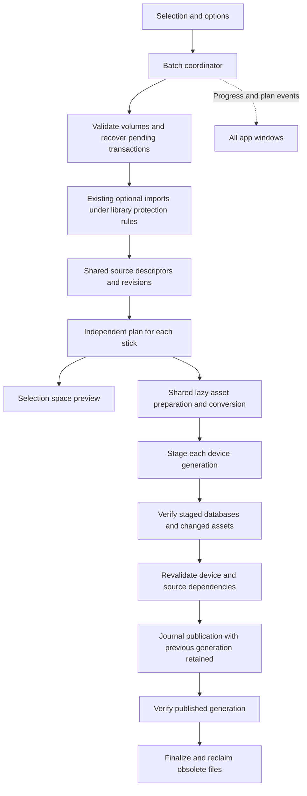

# USB sync performance and recovery implementation plan

Status: implemented and locally validated on `codex/usb-sync-redesign`;
release is blocked by the EOF CUE browser gate, pending cross-platform CI,
and outstanding player/media validation. Nothing in this document establishes that the
redesign is publicly shipped. This design
covers Sync Manager, Export Playlist, Export Folder, Export Track, and scripted
export. The objective is the shortest practical time from clicking SYNC to a
verified export, with useful feedback during selection and execution.

The exporter will build a change plan before performing expensive work. Audio,
analysis and cues, artwork, track metadata, playlists, and settings will have
separate change records. A playlist edit will update the database generation
without reading or rewriting unchanged media. Each destination will have its
own plan and recoverable transaction, while source inspection and conversion
work will be shared across the batch.

## Requirements and acceptance

| Requirement | Required behavior |
| --- | --- |
| Efficient sync | No content reads, decoding, conversion, or writes for media whose recorded state still matches. Detect changes with inexpensive file information first. |
| Playlist changes | Membership, name, folder, and order changes update the database pair; shared tracks count once. An identical selection and unchanged inputs produce a no-op. |
| Existing rekordbox export | Read its current device databases, identify tracks by source database and content IDs, preserve device data, and establish an RBXport baseline without blindly copying everything. |
| Files updated outside RBXport | Detect changes in source and destination file information. Hash changed or uncertain files, invalidate dependent outputs, and repair only what needs repair. |
| Missing and unreadable files | Retain a usable existing device version where possible; skip new tracks with no usable version; finish the other tracks and explain every incomplete update. |
| Multiple sticks | Share source work; plan, stage, verify, publish, cancel, and report independently per physical volume. One device failure does not abort unrelated destinations. |
| Compatibility mode | Probe only new or changed inputs; reuse valid MP3, WAV, or AIFF conversions using a versioned conversion profile; convert a shared input once per profile. |
| Recovery | Stage complete replacements, validate them, journal publication, and retain the previous generation until published verification succeeds. Never discard the recovery record while the generation is unresolved. |
| Selection feedback | Recalculate additional space and space left when playlists or export options change, separately for each selected stick. |
| Execution feedback | Show planning, reuse, conversion, bytes copied, database work, verification, publication, recovery, and per-device outcomes. |

Keep the existing distinction between additive context-menu exports and Sync
Manager's replacement of its selected library playlists. Keep library-owned
files on a destination protected, along with device-only tracks, playlists,
history, cues, My Tags, settings, and stable player-facing IDs.

## Current implementation and remaining costs

The inspected implementation is `dev` at
`1cd4505bc8340a27a63068a751f10c15df00714b`, on October 12, 2026. These are
source observations, not measurements of a physical USB export.

The performance request is [issue 293](https://github.com/chrisle/rbxport/issues/293),
implemented through [PR 303](https://github.com/chrisle/rbxport/pull/303). It added
destination copy stamps so unchanged audio does not need a complete read-back
on every sync. Its reported local-disk benchmark does not establish current USB
end-to-end performance. [Issue 304](https://github.com/chrisle/rbxport/issues/304)
concerns the additive context-menu export workflow.

| Current code | Work still performed |
| --- | --- |
| `src-tauri/src/commands.rs`: `ExportSelection::from_playlists_and_tracks`, `source_track`, `read_analysis` | Eagerly reads and parses source DAT/EXT/2EX for selected tracks. Estimate, missing-file validation, and execution each build a selection. |
| `crates/rbl-export/src/lib.rs`: `export_cancellable` | Reads the destination snapshot, reconciles tracks, transforms selected analysis, and rebuilds the databases on every export. |
| `crates/rbl-export/src/snapshot.rs`: `analysis_stamp` | Reads all referenced destination analysis companions before staging and again before publication. |
| `crates/rbl-export/src/reconcile.rs`: `sources`, `fill_source_details` | Reconstructs device tracks and eagerly reads their analysis, including assets retained from earlier or external exports. |
| `crates/rbl-export/src/verification.rs`: `verify_staged`, `verify_assets` | Checks every track and parses reused analysis again, including repeated DAT reads. |
| `crates/rbl-export/src/estimate.rs`: `estimate` | Uses a separate approximation of execution decisions; reads device state and probes source audio in compatibility mode. |
| `crates/rbl-export/src/lib.rs`: `adopted_paths` | Adopts a rekordbox copy using identity and matching size, without establishing byte equality. Equal size alone cannot prove that the source has not changed. |
| `src-tauri/src/commands.rs`: `sync_devices` | Clones an owned selection with analysis bytes per stick; each worker independently probes, hashes, and converts. |
| `src-tauri/src/commands.rs`: `write_export_with_phase` | Writes some settings and verifies databases after the core publication has already retired its recovery journal. |
| `src/store/useExportProgress.ts`: `exportPercent` | Uses processed track count for percentage, so a large conversion and a reused track count equally; long preparation and final stages have little detail. |
| `src/views/sync/SyncManager.tsx`: estimate effect and space bar | Already debounces selection estimates and displays projected additions/removals. The current calculation is copy bytes minus reclaimable bytes; it does not model the complete final allocation and peak recoverable staging requirement. |

The existing manifest, reconciliation rules, format writers, and publication
journal remain useful. Their costs and ownership boundaries need to change
together. Also correct the stale pipeline-reference passages claiming that
context-menu playlist exports replace the selection and that missing DAT
always fails selection construction; those passages disagree with this code.

## Proposed architecture

Introduce these explicit backend types in `rbl-export`; Tauri only supplies
library access, application cache paths, jobs, cancellation, and events:

- `SourceDescriptor`: track identity, canonical export metadata, cues/tags,
  source and analysis locations, and lightweight file revisions. No eager
  analysis bytes or decoded audio.
- `SourceSnapshot`: immutable library revision and deduplicated descriptors,
  playlist tree/membership, settings inputs, and batch options.
- `DeviceBaseline`: current device identities, rows, history, ownership,
  database signatures, asset revisions, and verification receipts.
- `SyncPlan`: reconciled desired state, per-asset actions and reasons, database
  changes, missing-file outcomes, space requirements, and captured dependencies.
- `PreparedAsset`: immutable prepared output, content digest, output properties,
  verification result, and source/profile revision. Share using `Arc`.
- `SyncJob`: batch and job IDs, physical volume identity, state, sequence number,
  counters, cancellation, timing, and terminal report.

The planner must be the sole owner of reuse/copy/convert/delete decisions.
Preview and execution use the same rules. An estimate may contain unresolved
conversion sizes; execution resolves those fields and checks the resulting
space requirement before publication. An old preview never authorizes writes.

Use maps for track identity, device IDs, playlist IDs, paths, parent membership,
and references. Remove repeated linear searches from reconciliation,
verification, and dependency lookup. Planning should scale with tracks plus
playlist entries, rather than their product.

## Change records and cache validity

### Manifest and local cache

Create manifest version 2 with a generation ID, source DBID, writer/transform
versions, canonical desired-state digest, device database signatures, retained
row state, and separate records for audio, analysis, artwork, and settings.
Each record contains path, ownership, observed file revision, versioned content
digest, and its validation receipt. Save it inside the device transaction.
Record the destination revisions as observed on the actual filesystem after
publication, accounting for timestamp precision and remount behavior. Seal
those receipts and the final manifest under the retained journal before
finalization; do not record local staging timestamps as though they were the
stick's durable timestamps.

Keep a disposable persistent source/probe/conversion cache in the application's
cache directory, supplied to the core through configuration. Losing the local
cache increases work without changing correctness. Completed device manifests
remain authoritative for what RBXport published. Bound cache size, use eviction,
and keep entries used by active jobs pinned. Never put recovery journals in this
evictable cache.

Read version 1 explicitly. Preserve its IDs and ownership, import known
fingerprints, and validate unproven assets lazily. Unknown future versions or
corrupt manifests trigger reconciliation from device databases, without
granting ownership of external files or deleting them. An older app encountering
version 2 must conservatively ignore it, as the existing loader does.

Use a modern versioned content digest such as BLAKE3 for new records, with the
algorithm named in the schema. Do not compare new digests with the existing
FNV values or invalidate every good copy solely to upgrade the hash algorithm.
Canonical metadata hashing must include every field actually consumed by the
format writers, preserving meaningful playlist ordering and duplicate entries.

### Source detection

Inspect file information once per unique source per batch: existence, size,
mtime at available precision, and filesystem/file identity and change time
where the platform exposes reliable values. Record unavailable fields
explicitly. Check the same revision before and after reading a changed source;
never save a digest from a file that changed during its read.

Cache the codec probe under the source revision and probe-policy version. Cache
analysis descriptors and transformation outputs under companion revisions,
cue values, audio destination path, and transform version. Artwork has its own
revision and digest. Metadata edits invalidate only the fields and outputs
that depend on them.

Filesystem notifications and RBXport's own edit/analysis revision counters
invalidate caches promptly, but do not replace filesystem checks after a
restart, watcher overflow, disconnect, or external edit. Reanalysis during a
sync either belongs to the captured source snapshot or causes affected assets
to be replanned; do not combine old waveforms with new cue/metadata revisions.

### Destination detection

Capture signatures of `export.pdb`, `exportExt.pdb`, `exportLibrary.db`, relevant
SQLite companions, sync records, history, and settings. Hash database bytes
once per inspection rather than relying only on DB mtime, because this is much
less data than the audio library. Read consistent SQL state through the
read-only database layer; if active companions or repeated changes prevent a
stable view, block that destination with an actionable conflict.

When signatures match a verified manifest, reuse its normalized row baseline
instead of parsing all device rows repeatedly. A changed signature invokes
full database reconciliation. It does not automatically invalidate every audio
or analysis record: reevaluate the records associated with changed rows,
paths, identities, or profiles.

Inventory referenced media paths using one memoized file-information lookup per
asset per inspection. Group directory enumeration where it is demonstrably
faster and returns sufficient information; preserve missing-file detection
on platforms requiring individual stats. Do not recursively scan unrelated
music or depend on directory mtime to prove child contents unchanged.

Unchanged assets with matching file revisions and versioned validation receipts
require no content read. Changed or uncertain assets receive a content hash
and, where required, parsing. Recheck dependency revisions and database
signatures immediately before publication. Reused analysis stays protected
against ordinary external cue edits without two complete analysis reads.

### Detection limits

Size and timestamps cannot prove byte equality if an external tool deliberately
preserves all observable revision fields, especially on FAT32. Default sync
uses the documented revision trust model to remain fast. A user-invoked
full verification or rebuild checks contents and renews receipts; uncertainty,
an unreadable revision, or inconsistent observations takes the conservative
path. Do not claim perfect arbitrary corruption detection without reading all
bytes. Normal same-size edits with changed mtime or reliable change time must
be detected and covered by tests.

## Decisions for each kind of change

| Change | Required work |
| --- | --- |
| No change | Validate revisions and signatures; return “Already up to date” without rebuilding databases, refreshing sync timestamps, or publishing. Honor explicitly requested settings changes and eject separately. |
| Playlist membership or order | Update playlist records in both staged databases; reuse unchanged audio, analysis, and artwork. |
| Playlist name or folder hierarchy | Update playlist/tree records and sync selection; preserve stable IDs and empty folders. |
| Rating, comment, key, or other metadata | Update affected database records; regenerate only dependent analysis, artwork, or paths when a writer actually requires it. |
| Audio changed | Hash/inspect the changed input, copy or convert it, update dependent output properties and invalidate stale analysis relationships. |
| Cues, grid, waveform, or analysis changed | Read and transform only affected companions; reuse audio. Preserve external edits under the existing conflict/import rules. |
| Artwork changed | Prepare one output per unique artwork revision and update referencing rows. |
| Compatibility target or converter version changed | Reevaluate affected conversions; reuse original media already compatible and unaffected preserved device tracks. |
| Artist/album metadata changes a generated audio path | Plan a journaled same-volume move when safe, rather than a USB content recopy; update PPTH and its firmware-derived analysis path together. |
| Destination audio missing or modified | Repair only affected selected tracks from a usable source; report when repair is impossible. |
| Track deselected | Apply existing ownership/reference rules before scheduling cleanup; protect external, in-place, loose, history, and device-playlist references. |

The database pair may still be rebuilt as a complete staged generation. Full
database serialization is acceptable for correctness; full media processing
is not required by it. Reuse cached encoded track rows where IDs and dependent
intern tables permit, but keep deterministic complete format validation. Do
not patch live DeviceSQL pages or OneLibrary rows to gain speed.

## Rekordbox and external device changes

For a first RBXport sync, or after another writer changes the device, read the
current databases and reconcile using master DBID/content IDs and stable device
IDs. Never infer identity from title or filename. Preserve paths and device
content that does not belong to the requested export.

Adoption requires evidence about content as well as identity. Reuse a matched
original copy when a trusted prior digest proves equality. Without that
evidence, compare the source and destination content once; matching size alone
is insufficient. Hash each unique path once, preserve identical copies in
place, and save the new receipt. This initial adoption can be slower than a
later sync and must show “Checking existing rekordbox export” with checked
counts/bytes. A cancelled adoption leaves the device unchanged.

A rekordbox conversion without a provable matching input/profile relationship
is not a trusted RBXport conversion. Generate the required output for that
selected track if necessary, while retaining its prior usable generation
until commit. A same-size source update must not be lost through adoption.

If the two device databases disagree, retain the existing selective-conflict
behavior: selected records that will be replaced can be resolved by this
export; unrelated ambiguity is explained and blocks publication on that
stick. Do not silently choose one database for unrelated data.

Before a fresh export, existing optional history/settings/rating imports run
under their current preferences, permissions, and Library Protection rules.
Imports remain ordered before capturing the final source snapshot. Cache
invalidation must include imported changes. An import failure makes that stick
ineligible for export while other eligible sticks can continue. Preserve the
current documented rating precedence; do not introduce concurrent library
imports or silently change how conflicting device values are resolved.

## Missing files and unsuccessful updates

Resolve missing files per destination rather than treating a source failure as
one global answer. The preflight prompt lists tracks and their device outcomes.

| Source and device state | Outcome |
| --- | --- |
| Source missing; usable matching copy exists | Keep the previous device track, audio, analysis, cues, and output format. Allow the requested playlist to reference its stable ID. Report that its source was unavailable and its existing version was kept. |
| Source missing; no usable copy | Skip the new track and omit its membership from the exported playlist. Export the other tracks and keep the playlist/folder even when it becomes empty. |
| Read, conversion, or copy fails; old version usable | Keep the old complete track representation. Do not combine its audio with new incompatible metadata or remove it as stale. Report the update failure. |
| Required analysis missing | Keep a valid existing bundle when it belongs to the retained audio/version; otherwise export without analysis where existing policy permits, with a warning. Do not invent a beat grid or advertise complete analysis. |
| External device track already has missing audio | Preserve the existing externally owned record and describe that known state; it is not a newly introduced missing reference. |
| Volume gone, disk full, permission failure, unstable database, or journal error | Abort that device transaction. These are not harmless per-track skips. |

When a requested compatibility change cannot be made because the source is
missing, the kept version is explicitly reported as the old format. Keep
“Complete with warnings” separate from “Fully updated”; retain the existing
policy preventing automatic eject on skipped/failed work. Represent warnings
as structured track ID/reason/outcome fields rather than parsing English
strings in the frontend.

## Shared conversions and multiple devices

Share source descriptors and lazily prepared outputs across device jobs. A
conversion cache key includes source identity/content revision, target
container, sample rate, bit depth, channels, bitrate, converter/resampler
version, and relevant compatibility policy. The existing profiles are
44.1 kHz stereo PCM16 for WAV/AIFF and 320 kbps MP3; retain these policies unless
a separate product decision changes them.

Use a batch lookup by captured source revision so simultaneous workers await
one preparation. Finalize the persistent content-addressed cache only after
the source is stable and the output validates. Hash original audio while
copying; hash conversion input through its read stream where practical,
including any unread trailing bytes before finalizing the digest. Avoid a
second complete USB output read solely to compute a hash. Keep the independent
changed-output verification needed for container and playback properties.

Prepare transformed analysis separately for device-specific paths and IDs;
two sticks may share conversion bytes without sharing an identical PPTH or
database row. Keep bounded preparation buffers and a fallback that streams
to the device stage if local cache space is unavailable. Report reduced reuse
when that fallback requires independent conversions.

Use one sequential device writer per physical volume and bounded CPU/source
workers across the batch. Start with at most two conversion workers, then tune
from measurements. Deduplicate destinations by physical volume identity, not
mount-path text; aliases must not create two concurrent writers. Recheck the
volume identity after disconnect/reconnect on Windows as well as Unix.

A slow stick must not accumulate unbounded buffered work or stop a fast stick.
Per-device Stop detaches that consumer; shared work continues while another
device needs it. Stop All cancels preparation and staging everywhere, while
publication/recovery finishes its required transaction boundaries. Report
batch time to the last finished destination and each device's own duration.

## Recovery and publication contract

Before publication, existing live databases and media remain unchanged. New
outputs and complete databases are staged and validated. No write, deletion,
or same-volume move that affects the live generation occurs outside the
journal. Include manifest, sync records, settings/defaults, SQLite companion
handling, path moves, and ownership-qualified cleanup in the transaction.

Extend `rbl_core::durable::Publication` into explicit prepare, publish, verify,
finalize, and recover operations. It currently retires the journal inside
`commit`; the redesign must retain staged/previous images and the commit record
until the caller verifies the published database pair and required changed
outputs. Migrate/replay existing journals before creating a new transaction.

Persist generation identity, expected previous/new signatures, operation
ordering, and recovery state. Flush required images and intent before the
first live move. Replacements use same-filesystem renames; preserve Unicode,
case-folding, FAT/exFAT behavior, AppleDouble handling, and SQLite WAL rules.
Keep original file names in the journal so rollback is unambiguous.

For an ordinary failure with an accessible volume, finish publication if the
verified new images remain usable, or restore the entire previous generation
through a journaled rollback. Verify the resulting generation before declaring
the device usable. Recovery is idempotent and survives interruption during
rollback as well as roll-forward. A conflict with an external writer retains
both recovery evidence and an explicit blocked state; do not overwrite that
writer to clear the error.

All device readers, editors, imports, estimates that depend on a coherent
generation, and eject paths must recognize pending recovery. Recover under
the device lock before exposing a library; if recovery fails, show the reason
and do not offer that device as ready. Passive estimates must not repair or
mutate the stick; they show “Recovery required” until an authorized sync or
recovery operation completes.

Delete obsolete owned assets only once no published database/history/retained
generation needs them. A failed cleanup is retryable and reported separately
from database verification. Clean up a finalized journal only after its
retirement is durable. Cache eviction must never remove its images.

### What interruption guarantees mean

The player formats use several fixed database filenames and firmware-derived
analysis paths. FAT32/exFAT do not provide one atomic operation replacing all
of them. Consequently an unplug during the short publication interval can
leave a temporarily mixed generation until RBXport recovery runs. Individual
replacement files must be complete, and a complete old/new generation must
remain recoverable in the journal.

The acceptance contract is: preparation failures preserve the old usable
library; ordinary publication failures return only after restoring/verifying a
complete generation, or explicitly report that recovery is required; a device
interrupted during publication is never called ready until recovery completes.
Instant player readiness after arbitrary removal during publication is not a
guarantee this fixed-path format can honestly provide. Physical media damage
and power-loss filesystem corruption also cannot be eliminated by an app
transaction. Keep these boundaries visible in the UI and tests.

## Space preview when selecting playlists

Recalculate every selected stick when playlists/folders are selected or
deselected, intelligent-playlist membership changes, compatibility settings
change, cleanup options change, library revisions change, or the device is
mounted, modified, synced, or refreshed. Start lightweight device inspection
when the stick is selected and share its results with subsequent previews.

Debounce selection changes by approximately 150–250 ms. Each request carries
selection/options/library revision and device identity/signature tokens. Cancel
superseded work and reject stale responses in the UI. Update immediately to a
“Calculating space…” state; do not keep presenting an old number as current.
Register jobs and progress before expensive planning or automatic imports.

The backend returns per-device fields with confidence/status:

- Current capacity, available bytes, and measured used bytes.
- Selected unique tracks, already present/reused tracks, new/updated tracks,
  kept old versions, and skipped tracks.
- New audio bytes, replacement audio bytes, changed analysis/artwork bytes,
  database/manifest/settings allowance, and reclaimable owned bytes.
- Net additional used space after a successful sync.
- Peak additional staging/recovery space, including coexistence of the old
  generation and new outputs.
- Projected available bytes after sync, predicted peak available bytes, and
  whether enough space exists to complete safely.
- Exact/estimated/unknown sizes, uncertainty range, and unresolved reasons.

Do not count a track twice because it occurs in several playlists, and do not
count an existing valid USB copy as a new copy. Removing a playlist may reclaim
zero audio when another playlist or history still references it. Account for
per-file filesystem allocation where cluster size is known; otherwise include
a conservative allowance and label the estimate. Include full staged database
sizes, rather than just the number of edited playlist rows.

Use one accounting model: let `S` be the allocated bytes of new final outputs
that must be staged, including complete replacement databases; let `R` be
previous allocations released only after verification, including replaced
database images; and let `J` be temporary journal/scratch allocation. Then
`additionalUsed = S - R`, `freeAfter = freeNow - S + R`, and conservative
`peakAdditional = S + J + safetyAllowance`. Old files moved into the journal
are already included in current usage and must not be counted a second time.
Same-volume asset renames consume no second content allocation. Local
conversion-cache requirements are checked separately from USB requirements.
Show signed additions/removals in text, clamp only the bar's rendered range,
and expose uncertain values instead of hiding an over-capacity result.

WAV/AIFF size estimates derive from duration, output rate/channels/bit depth,
and container overhead; MP3 estimates include encoded frames and metadata.
Use exact completed conversion sizes when cached. If duration or required
device information is unavailable, label the estimate as incomplete and plan
inspection; never display a confident zero. Do not perform conversion merely
to repaint the selection bar. Recompute after resolving uncertain outputs.

The space bar shows existing usage and projected additional usage, with a
separate indication of space to be reclaimed. Text says, for example,
“Adds about 1.2 GB · 8.4 GB left after sync.” A nearby peak-space line explains
“Needs 1.5 GB free while syncing.” Distinguish an over-capacity final library
from insufficient temporary space. Do not credit future deletions as free
staging space while those files protect the previous generation.

For multiple sticks, each row has its own bar and verdict. Show capacity and
drive name together; one shared percentage cannot describe devices with
different contents or capacities. Insufficient space excludes that stick
until corrected, while clearly allowing eligible sticks to continue. Recheck
actual free space before staging and while writing, since a preview is not a
reservation against external writers.

## Execution progress and result UI

Extend progress through `src/ipc/` with `batchId`, `jobId`, sequence, device
identity, stage, current operation/track, units, completed/total work, bytes,
conversion time processed/total where available, counters, elapsed time, and
`canCancel`. Store the latest state in the backend so opening another window
mid-sync displays the same job. Ignore events from older jobs/sequences.

Display stages with meaningful counters:

| Stage | Example feedback |
| --- | --- |
| Inspection and recovery | Checking USB library; recovering interrupted export when required. |
| Planning | Checking 4,812 tracks; 4,780 already on this stick; 32 need changes. |
| Conversion | Converting 3 of 12 tracks to MP3; current track and processed duration. |
| Copying | Copying 420 MB of 1.2 GB; transfer rate and current track. |
| Database | Updating 3 playlists; writing Device Library and OneLibrary. |
| Verification | Checking new files and databases; unchanged files reused. |
| Publication | Saving verified export; Stop disabled until publication/recovery finishes. |
| Finalization | Checking saved library, reclaiming old files, then safely ejecting if requested. |
| Result | Already up to date, Complete, Complete with warnings, Cancelled, Failed with previous library restored, or Recovery required. |

Stage-local progress uses actual units: counts for planning, bytes for copying,
and duration/frames for conversion. Show elapsed time for operations without
a useful denominator. Never show 99% throughout database or verification
because all tracks were visited. If an overall percentage is retained, its
weights come from the planned work and it reaches 100% only after verified
finalization; stage text remains the primary explanation.

Throttle progress to roughly 5–10 updates per second while delivering stage
transitions and terminal events immediately. Estimate remaining time only
when enough throughput history exists. Include the preview/plan counts in
the result: reused, copied, converted, metadata-only updates, playlists
changed, removed, old versions kept, and skipped/failed with reasons. Preserve
per-device results instead of replacing all statuses with whichever worker
emitted last. All strings use `useTranslation()`; Rust emits structured codes
and data, and views never invoke Tauri directly.

## Measurement and release gates

Measure end to end from SYNC click, including preflight, optional imports,
selection construction, planning, copying/conversion, database building,
verification, publication, cleanup, and optional eject. Separately measure
selection-change latency to the updated space bar. Log stage durations,
filesystem lookup counts, source/USB bytes read, USB bytes written, database
opens/parses, cache hits, probes, conversions, peak memory, and cache/stage
space. Use aggregate diagnostics without exposing music paths publicly.

Add a dedicated Rust export benchmark/operation-count harness; the existing
browser performance scripts do not measure USB work. Generate disposable
libraries and audio fixtures. Use 200, 2,000, and 10,000 tracks with realistic
DAT/EXT/2EX bundles, shared artwork, overlapping and intelligent playlists,
folders, duplicate membership, and history. Include one and three
destinations. Keep before/after source commits and raw results.

| Workload | Deterministic acceptance gate |
| --- | --- |
| Warm unchanged sync | Zero media content reads/writes, zero codec probes/conversions, zero database rebuilds. File-information checks and device-signature reads are counted separately. |
| Playlist membership/name/order only | Zero unchanged media content reads/writes or conversions; only the database/sync/manifest transaction changes. |
| One changed audio file | Only that track's audio and genuinely dependent assets are prepared; other media receives no content reads. |
| One changed cue/analysis/artwork | Only changed/dependent assets read or written; audio bytes copied remain zero. |
| Compatibility no-change resync | Zero probes, conversions, or converted output recopy. |
| Three sticks needing one shared conversion | One conversion per unique input/profile when the cache is available; independent destination copies and databases. |
| Existing rekordbox stick | Initial uncertain adoption establishes equality once; the next unchanged export satisfies the warm gate. |
| Add a playlist containing existing tracks | Preview counts only genuinely additional output and database/staging overhead. |
| Stale estimate completes after a new selection | Old response never updates the bar or authorizes execution. |

Provisional performance targets for the agreed 10,000-track physical reference
workload are a p95 playlist-only completion of 5 seconds on a fast USB 3 stick
and 15 seconds on a slower stick, and p95 preview updates within 500 ms once
the device baseline is available. These are engineering targets, not measured
claims. Establish hardware/filesystem baselines first and record any revised
budget with the bottleneck and reason. Cold adoption/reconciliation must have
separate timings, since it cannot share the warm guarantee.

For large copies, target at least 85% of the same device's durable sequential
copy throughput using the same total data and flush policy. Compare total
time, including verification and publication. Run at least 20 controlled
warm repetitions for latency percentiles, plus cold-cache repetitions; report
hardware, filesystem, connection/hub, OS, free space, and optional import/eject
settings. Operation-count tests are the portable regression gate; physical
timing budgets belong to recorded reference-hardware runs.

## Correctness and recovery tests

Extend export, reconciliation, manifest, estimate, conversion, and durable
tests before replacing the current path. Cover the following scenarios using
`RB_LITE_TEST=1` and temporary `rbl_db::fixture::build` libraries:

- Source replacement, same-size edits, restored mtime with detectable change
  time, coarse FAT timestamps, missing revision fields, changed destination
  audio/analysis, and explicit full verification of stamp-preserving edits.
- Fresh rekordbox export, external re-export, reordered/removed records,
  inconsistent databases, missing/corrupt/version 1 manifests, unfamiliar
  future manifests, Unicode paths, PIONEER/.PIONEER conflicts, and protected
  source audio already on the destination.
- Missing sources with and without usable copies on different sticks,
  missing DAT/EXT/2EX, empty playlists/folders, duplicates, device-only tracks,
  retained history/cues/tags/settings, and cleanup ownership/reference rules.
- Original media plus MP3/WAV/AIFF conversion, profile changes, source changes,
  output property verification, source modification during preparation,
  corrupt/evicted cache entries, local cache exhaustion, and one conversion
  failing while other tracks/destinations succeed.
- Per-volume alias rejection, mount-path reuse after unplug, one slow or failed
  stick, per-device cancellation, Stop All, bounded memory, and shared work
  with consumers attaching/detaching.
- Disk full and permissions during staging/publication, read-only devices,
  lost images, external writers, corrupt journals, and interrupted cleanup.
  Inject interruption after each journal/rename/flush boundary, including
  rollback and post-publication verification. Restart recovery twice and
  assert idempotence, whole-generation consistency, stable IDs, valid paths,
  and correct ownership. Verify by independent parsers, not only reports.
- UI preview deduplication, additions/removals, compatibility estimates,
  insufficient peak space despite sufficient final space, stale/cancelled
  responses, missing-file outcomes, multiple devices, progress replay across
  windows, stage ordering, and warnings/recovery/eject states.

Validate physical FAT32 and exFAT exports on macOS, Windows, and Linux and
HFS+ where supported, using explicitly disposable media. Check representative
legacy Device Library and OneLibrary players with `rbl-difftool`, registered
emulator gates, and physical browse/load/play tests. Keep `[OBS]`, `[ASSUME]`,
and `[UNKNOWN]` markers for changed layout/protocol behavior. Emulator success
does not replace physical-device evidence. Never use an installed rekordbox
library as a writable test fixture.

## One coordinated implementation

### Validation evidence (in progress)

The implementation adds deterministic tests in `tests/redesign.rs`,
`tests/performance.rs`, `tests/removable_media.rs`, and durable publication
tests. The measured prototype passed zero-media-read/write assertions for
playlist-only sync and zero rebuild/probe/conversion assertions for no-op sync.
Three destinations performed one shared MP3 conversion. MP3/WAV/AIFF cache
repair, copy cancellation, mount-path reuse, source races, source absence,
analysis-only changes, and explicit stamp-preserving integrity checks passed.
FAT32/exFAT disk images passed export/resync, old journal replay, and rollback
from invalid published databases. These are disposable filesystem tests, not
physical player proof.

An opt-in local debug-build run, with other builds/browser/emulator checks
running concurrently, recorded the following prototype timings. The run
predates the final fast preview return and streaming signature serialization;
do not use it as the release build or physical reference-hardware baseline.

| Tracks | Cold export ms | No-op p95 ms (20 runs) | Playlist edit ms | Preview ms |
| --- | ---: | ---: | ---: | ---: |
| 200 | 5874 | 48 | 837 | 116 |
| 2,000 | 54986 | 1128 | 3854 | 1505 |
| 10,000 | 449689 | 2785 | 14153 | 7811 |

The 10,000-track playlist edit read/copied zero media, performed one database
build, and recorded 200072 instrumented revision lookups. Cold synthetic media
uses 8 KiB audio placeholders and DAT/EXT/2EX fixtures, so its timing is dominated
by per-file work rather than realistic sequential USB copy throughput.

Final integration includes `dev` through `1c1c39ee`, retaining its playlist,
PDB, and historical rating migration fixes. Frontend lint/type checks, all
1,257 unit tests, the production build, unchanged size budgets (148.3 KiB
initial / 324.6 KiB total gzip), and all 17 locale catalogs passed. All 18
Sync Manager/production-window checks passed on Chromium and WebKit.
The complete browser run finished with 819 passed, 10 skipped, one WebKit
process crash passing on retry, and the same EOF CUE test failing in both
browsers. That test also failed on untouched `1cd4505`; it remains a release
gate, not a waived test. The final `RB_LITE_TEST=1 cargo test --workspace`
run passed, including all 48 native command tests and doc tests. Workspace
Clippy with warnings denied and all 16 focused redesign tests passed.

The implementation is pushed in [draft PR 385](https://github.com/chrisle/rbxport/pull/385).
Cross-platform CI is pending. No release is dispatched. The public feed still
reports version 1.6.0 as checked on October 12, 2026. Original issue 293 is
closed for its earlier shipped optimization; PR 385 is the follow-on overhaul.
Source hashing now checks
cancellation between 64 KiB chunks. Compatibility conversions discard source
VBR byte offsets, and volume identity handles close before automatic eject.

Firmware gates were attempted. CDJ-3000 failed to become ready (control endpoint
connection refused). XDJ-AZ failed before browse/load validation; its guest log
reports `ENOSPC` in `TrackFileCache`. Neither establishes player compatibility.
Physical Windows/Linux/macOS player/media timing targets remain unverified.

Compatibility note: database/request/recipe signatures and converted cache
digests use BLAKE3; existing media/analysis comparison hashes retain the legacy
FNV representation. The slow integrity option checks source and USB contents,
and invalidates stale preparation receipts. Changing only source file
information, with proven identical bytes, does not recopy audio or analysis.

The following is the internal dependency order for one implementation branch
and one integrated delivery. No partial rollout exposes the new planner while
old recovery or progress contracts remain active.

1. Add end-to-end timing and operation-count fixtures; record the existing
   baseline and encode the acceptance scenarios above.
2. Implement source descriptors, revisions, cache keys, manifest version 2,
   migration, and shared preparation without changing published behavior yet.
3. Implement per-device baseline/reconciliation and the unified planner,
   including missing-file retention, ownership, conversions, and space models.
4. Extend durable publication with retained generations, published
   verification, rollback/replay, journal migration, and centralized device
   recovery state. Move settings and cleanup into the intended transaction.
5. Connect the executor and batch coordinator, lazy verification, bounded
   workers, cancellation, and shared conversions to all export entry points.
6. Replace preview/progress/report IPC and mocks together; add live space bars,
   accurate stage feedback, structured warnings, and translations.
7. Remove duplicate estimate/validation decisions and eager media reads;
   update format/pipeline/user documentation. Run the complete integrated
   correctness, performance, recovery, emulator, and physical acceptance set.
8. Deliver the integrated change only after the gates pass. Keep planning,
   implemented, tested, merged, and publicly shipped statuses distinct.

| Area | Main change locations |
| --- | --- |
| Planner, manifests, reconciliation, verification | `crates/rbl-export/src/`, `crates/rbl-export/tests/` |
| Journaling, moves, rollback, recovery | `crates/rbl-core/src/durable.rs` and its fault-injection tests |
| Streaming conversion, probe/result cache inputs | `crates/rbl-audio/src/compatibility.rs` |
| Source descriptors, imports, jobs, device coordination | `src-tauri/src/commands.rs`, app state, device/settings/import commands |
| Backend DTO and frontend contract | `src-tauri/src/dto.rs`, `src/ipc/types.ts`, `client.ts`, `backend-mock.ts` |
| Selection preview and execution UI | `src/views/sync/SyncManager.tsx`, `SyncWindow.tsx`, export progress store/components, `src/app/App.tsx`, `src/lib/exportSummary.ts` |
| Strings, behavior tests, documentation | `src/i18n`, Vitest/Playwright fixtures, `docs/reference/usb-export-pipeline.md`, `docs/reference/usb-export-db.md`, `docs/user/usb-export.md` |

Run focused checks while building, then the repository's substantial-change
gates: workspace Clippy with warnings denied, guarded workspace Rust tests,
`pnpm lint`, `pnpm build`, `pnpm test`, `pnpm budget`, and `pnpm e2e`. Run token
or icon generation only if their source files change. Verify actual release
ancestry and the public update feed when delivery is authorized; a closed issue
or a merged PR alone does not establish production availability.
