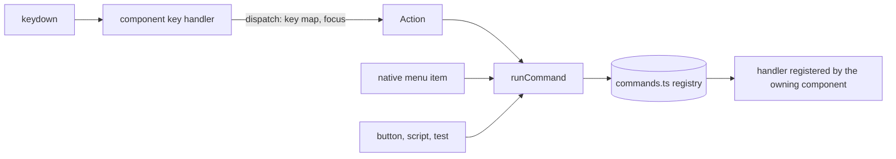

# Keyboard commands

[Documentation](../README.md) · [Conventions](../development/conventions.md)

This reference covers how a keyboard shortcut reaches the code that runs it,
and lists every bound action with its other entry points and what rekordbox
exposes for it. It started as the audit in #431, which found commands whose
behavior could only be reached by pressing their key.

| Area | Code |
| --- | --- |
| The key map, as rows | `src/lib/shortcuts.ts` (`BINDINGS`), `src/lib/keyPresets.ts` |
| The command registry | `src/lib/commands.ts`, `src/store/useCommands.ts` |
| Shell commands (search, master volume, Analyze Track) | `src/app/App.tsx` |
| Track list commands (selection, cursor, Renumber Track Order) | `src/views/browser/TrackTable.tsx` |
| Locate track loaded on deck | `src/lib/locateLoaded.ts`, `src/views/browser/TrackTable.tsx` |
| Deck commands | `src/views/player/Player.tsx` |
| EQ kill commands | `src/views/player/MixerStrip.tsx` |
| Native menu items | `src-tauri/src/menu.rs`, `src/lib/menu.ts`, `src/lib/nativeMenu.ts` |

## How a key runs a command

An `Action` in `shortcuts.ts` is a command. The component that owns the
state the command acts on registers its handler with `useCommands` while it
is mounted. It registers in a scope when there are several of that thing:
`a` and `b` for the decks, `main` and `sub` for the main browser's and the
sub-browser's track lists. A key handler only decides whether a press is
the command: the key map, where the focus is, and which deck or list it is
for. It then calls `runCommand(action, { scope, repeat })` and swallows the
key only when the command applied. A menu item or anything else calls the
same `runCommand`, so it gets exactly what the key gets.

A handler returns false when the command does not apply right now: the deck
is empty, the list has no rows, nothing is selected to load. The key then
falls through to the webview and the OS, as an unbound key does. `repeat`
is true for a held key's auto-repeat. A command that runs once per press
(Set Hot Cue, Memory Cue, SYNC, Mute) ignores repeats; a menu item never
sends one.

rekordbox is built the same way. Its keys are `juce::ApplicationCommandManager`
command ids, and its menu bar's items are `PopupMenu::addCommandItem` calls
on the same ids, so a key and a menu item reach the same
`MainComponent::perform` [OBS static, rekordbox 7.2.19 macOS arm64,
`MainComponent::getMenuForIndex` @0x100964638].

## What rekordbox puts in its menu bar

[OBS static] rekordbox 7.2.19's menu bar outside the project/lighting
branch is File, View, Track, Playlist and Help
(`MainComponent::getMenuBarNames` @0x1009643d8). It has no Edit menu. The
command id of every `addCommandItem` call in `getMenuForIndex`, with its
Keyboard-pane name, is in
`rbxport-worktrees/parity/issue-431/values-rekordbox-menubar-command-items.tsv`
next to the main checkout. None of the deck commands, Search (7003), Volume,
Volume Down or Mute (3003-3005), or Locate track loaded on deck (b139) is a
menu item. Command b139 is referenced only by `MainComponent::perform` and
`rb::KeyMappingEditorComponent::needModifier`.

## The audit

"Entry points" lists every way into the command after #431. "Menu bar"
says whether rekordbox 7.2.19's menu bar lists the command [OBS static, see
above]. Player B's rows are Player A's with shift and run the same commands
in the `b` scope. Keys are the Export preset's.

### Browser and shell

| Command | Key | rekordbox id | rekordbox menu bar | Entry points | Owner, scope |
| --- | --- | --- | --- | --- | --- |
| Search (`focusSearch`) | command + F | 7003 | no | key; clicking the search box | App, none |
| Clear Search (`clearSearch`) | esc | none (RBXport's own) | no | key | App, none |
| Analyze Track (`analyseSelection`) | shift + command + A (RBXport's own key; rekordbox's Export preset binds none) | 4000 | Track › Analyze Track | key; Track › Analyze Track (added in #431); list context menu | App, none |
| Select All (`selectAll`) | command + A | none (list built-in) | no | key | TrackTable, `main`/`sub` |
| Cursor Up, Down, Page Up, Page Down, to Top, to Bottom | cursor keys, page up/down, home, end, command + cursor up/down | none (list built-in) | no | key | TrackTable, `main`/`sub` |
| Extend Selection Up/Down (`extendUp`, `extendDown`) | shift + cursor up/down | none | no | bound but not implemented: #514 | none |
| Load on Player 1 (`loadPlayer1`) | enter, shift + enter | none | no | key; double-click a row; drag to the deck | Player, `a` |
| Locate track loaded on deck (`locateLoaded`) | command + L | b139 | no | key; Track › Locate track loaded on deck (#430) | TrackTable (main browser), none |
| Renumber Track Order (`renumberTrackOrder`) | unbound | 500e | Playlist › Renumber Track Order | key once bound; column header menu | TrackTable, `main`/`sub` |
| Volume, Volume Down (`volumeUp`, `volumeDown`) | command + F12, command + F11 | 3003, 3004 | no | key; the master knob sets the level directly | App, none |
| Mute (`mute`) | command + F10 | 3005 | no | key | App, none |

### Deck

| Command | Key (Player A) | rekordbox id | rekordbox menu bar | On-screen control that calls the same function |
| --- | --- | --- | --- | --- |
| Play/Pause | spacebar | 3006 | no | PLAY |
| Cue | C (held) | 3007 | no | CUE (held) |
| Quantize | Q | 301c | no | Q button |
| Jump Forward, Jump Reverse | cursor right, cursor left | 3008, 3009 | no | jump buttons |
| Memory Cue | M | 3024 | no | the memory store button |
| Call Previous/Next Memory Cue | B, N | 303a, 3039 | no | memory call buttons |
| Delete Memory Cue | X | 303b | no | the memory delete button |
| Memory Cue 1-10 | A to ; | 3025-302e | no | none |
| Loop In, Loop Out, Exit/Reloop | I, O, R | 300a-300c | no | loop buttons |
| 1 to 32 Beat Loop | 4 to 9 | 3012-3017 | no | the beat loop length and its start |
| Loop /2, Loop x2 | /, option + \ | 3018, 3019 | no | loop steps |
| Set Hot Cue A-H, Clear Hot Cue A-H | 1-3, command + 1-3; D-H unbound | 301e-3023, 3054/3055, 307f-308e | no | hot cue pads and their clear buttons |
| Show Memory Cues, Show Hot Cues, Show Information | F10, F11, F12 | 303f-3041 | no | panel tabs |
| Change Metronome sound | F9 | 3042 | no | none; the metronome menu picks a sound directly |
| SYNC, Master Tempo, Tempo Reset | F1, F2, F3 | 304b, 304d, 304e | no | SYNC, MASTER TEMPO, RST |
| BPM +, BPM - | F7, F6 | 3051, 3052 | no | none (the tempo slider) |
| Adjust BPM/BeatGrid | command + G | 303e | no | GRID pad mode |
| Shift Beatgrid left/right | command + cursor left/right | 3044, 3043 | no | grid shift buttons |
| Shift Beatgrid to the center | option + command + \ | 3045 | no | none |
| Low, Mid, High Kill (`eqKill*`) | unbound (RBXport's own) | none | no | mixer kill buttons (MixerStrip, `a`/`b`) |

Every deck command is registered by `Player` for its deck, and its key
handler only checks the deck and calls `runCommand`. A command on the
deck's track does not apply while the deck is empty (`playback.idle`), as
before. Jump, Load on Player 1, the panel tabs and the metronome sound
apply to an empty deck too.

### Keys that are not in the key map

- Delete and backspace in a track list run the same removal the list's
  context menu runs (`deleteKeyAction` in `src/lib/contextMenus.ts`).
- Releasing Cue's key, or the window losing focus, lets go of a held CUE
  (`dropCue`), as releasing the CUE button does.
- The menu accelerator rows (`menu.*` in `BINDINGS`) are the native menu's
  own items. On Windows, `menuAccelerator` turns the keystroke into the
  item's id and runs it as a click.

## Decisions and differences

- No command is left shortcut-only by a product decision. Commands with no
  rekordbox menu item and no on-screen control (the cursor keys, Mute, BPM
  + and -, Change Metronome sound, Shift Beatgrid to the center, Memory Cue
  1-10) are registered commands that any entry point can run. They get no
  new visible control, because rekordbox's menu bar has none for them and
  RBXport does not add features rekordbox lacks.
- Locate track loaded on deck is in RBXport's Track menu by the decision
  in #430, although rekordbox's menu bar does not list it [OBS static].
- Track › Analyze Track has no accelerator, as in rekordbox. On macOS a
  menu accelerator would take the key before the webview sees it, which
  would ignore a key changed in the Keyboard pane.
- Holding Shift Beatgrid left/right on the keyboard shifts the grid one
  normal step per repeat. Holding the on-screen button uses the larger held
  step. This predates #431 and was kept as it was. [UNKNOWN] What a held key
  does in rekordbox.
- rekordbox's other Track and Playlist menu items are not in RBXport's
  native menu yet: #513.
- [UNKNOWN] When rekordbox greys Track › Analyze Track
  (`BrowseBasicView::isActiveCommand` @0x1003153cc passes the question on
  to the list and tree viewers). RBXport's item is always enabled, and with
  nothing selected it does nothing, which is what the key does.
