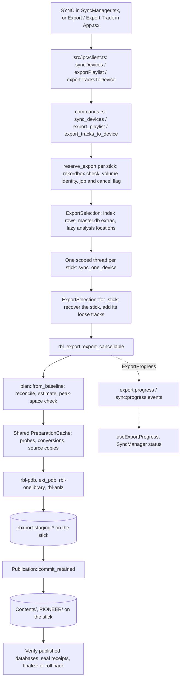
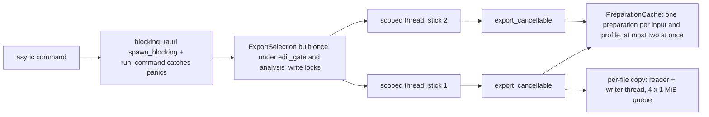
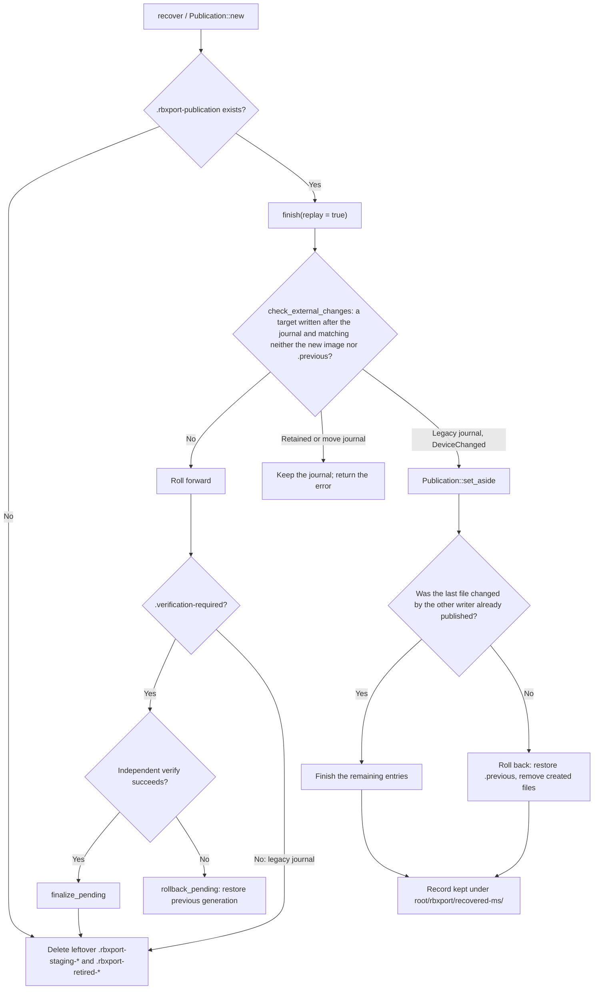

# How a USB export runs

[Documentation](../README.md) · [USB export format](usb-export-db.md) · [Export preferences](../user/usb-export.md)

This reference follows one USB export through the code, from the click in the
interface to the files on the stick. It is for engineers who are about to
change export or sync. It covers the order of the work, the reason for that
order, the safety checks, and where each step lives. The
[USB export format](usb-export-db.md) reference covers what the files contain.
This document links to it for format details and does not repeat them.

It describes `dev` as of October 14, 2026. The selective, recoverable sync
described here landed in `90cf4d36` and its follow-up fixes, after 1.7.0, and
is part of the 1.8.0 release cut (`f0f54401`). See
[Validation status](#10-validation-status).

| Area | Code |
| --- | --- |
| Sync Manager window, space bars, and progress | `src/views/sync/SyncManager.tsx`, `src/views/sync/SyncWindow.tsx`, `src/store/useExportProgress.ts`, `src/lib/exportProgress.ts`, `src/components/StopExport.tsx` |
| Main-window export (playlist, folder, Export Track, AppleScript) | `src/app/App.tsx` (`writeToDevice`, `exportTrackTo`) |
| IPC boundary | `src/ipc/client.ts`, `src/ipc/types.ts`, `src/ipc/backend-mock.ts` |
| Tauri commands, jobs, and the export selection | `src-tauri/src/commands.rs`, `src-tauri/src/sync_window.rs` |
| Stick defaults staged with the export | `src-tauri/src/device_settings.rs` |
| Orchestration | `crates/rbl-export/src/lib.rs` (`export_cancellable`) |
| Planning and space preview | `crates/rbl-export/src/plan.rs`, `estimate.rs` |
| Revisions, receipts, and signatures | `crates/rbl-export/src/incremental.rs` |
| Shared probe and conversion cache | `crates/rbl-export/src/cache.rs` |
| Reconcile, conflict checks, verification | `crates/rbl-export/src/reconcile.rs`, `snapshot.rs`, `verification.rs` |
| Incremental-sync record | `crates/rbl-export/src/manifest.rs`, `sync_record.rs` |
| Staging, publication journal, recovery | `crates/rbl-core/src/durable.rs` (`Publication`, `VolumeIdentity`) |
| Format writers | `rbl-pdb` (`export.pdb`), `rbl-export/src/ext_pdb.rs` (`exportExt.pdb`), `rbl-onelibrary` (`exportLibrary.db`), `rbl-anlz` (analysis), `rbl-audio` (conversion) |
| Drives | `crates/rbl-devices/src/lib.rs`, `mounts.rs`, `eject.rs`, `format.rs` |

## Contents

1. [The mental model](#1-the-mental-model)
2. [Frontend](#2-frontend)
3. [Tauri layer](#3-tauri-layer)
4. [The rbl-export pipeline](#4-the-rbl-export-pipeline)
5. [Devices and the filesystem](#5-devices-and-the-filesystem)
6. [Failure modes and guarantees](#6-failure-modes-and-guarantees)
7. [Testing](#7-testing)
8. [Where to start when changing something](#8-where-to-start-when-changing-something)
9. [Glossary](#9-glossary)
10. [Validation status](#10-validation-status)

## 1. The mental model

An export takes a selection from the rekordbox library and writes it to a
mounted volume as a player library. A selection is a set of playlists,
intelligent playlists, and folders, plus any tracks exported on their own.
The result has the audio under `Contents/`, analysis files under
`PIONEER/USBANLZ/`, artwork, and two library databases under
`PIONEER/rekordbox/`: the DeviceSQL `export.pdb` and the SQLCipher
`exportLibrary.db`. The [directory tree](usb-export-db.md#2-directory-tree)
lists every file.

**Export** and **sync** use the same code. The first export to a stick writes
everything. Each later export to the same stick is a sync. It reads the
manifest that the previous run left at `PIONEER/rbxport/manifest.json` and
does only the work whose inputs changed:

- An identical request against unchanged sources and an unchanged stick is a
  no-op. Nothing is rebuilt or published, and the result says "Already up to
  date".
- A playlist-only change (membership, order, name, folder) rebuilds and
  republishes the databases, the sync record, and the manifest. No audio,
  analysis, or artwork is read or written.
- A changed source file is hashed. If its bytes really changed, that track's
  audio and dependent analysis are prepared again. Other tracks are not read.
- Files that are no longer selected, and that this app wrote, are removed
  inside the same journaled publication.

Player-facing ids stay the same between syncs. If the manifest is missing,
unreadable, or from an unknown schema, the exporter reconciles from the
stick's databases instead. A version 1 manifest still supplies ownership and
stable ids, but cannot authorize fast reuse; the first sync with this build
establishes fresh receipts.

**What "unchanged" means.** Every source file, analysis companion, and artwork
image has a `FileRevision`: size, nanosecond mtime, and on Unix also ctime and
device/inode. Every output on the stick has a revision without ctime and
inode, because those do not survive renames and remounts. The manifest's
`generation` records the revisions of the inputs used and of the outputs as
they read back after publication (the *receipts*). A matching revision means
no content read. A changed or uncertain revision means a content hash, and
reuse only if the hash matches. Size and timestamps cannot prove byte
equality against a tool that deliberately preserves them; the optional
**Verify all files** check reads content instead (see
[Verify all files](#verify-all-files)).

**A stick another writer exported.** On a stick rekordbox exported, the
first sync from here has no manifest, but `exportLibrary.db` names each
track's library row by `masterDbId`/`masterContentId`. A selected track the
stick holds for this library (`db_id` not 0), whose file at that row's path
has the same size as the source and then compares byte-for-byte equal, is
kept where it is and not copied again (`adopted_paths`). The comparison
reports `checking` progress in bytes ("Checking existing rekordbox export")
and can be cancelled. The manifest then records the track as this export's,
with the source's hash and the copy's stamp, so later syncs treat it as one
they wrote. rekordbox's export does the same: `DatabaseMediator::execExport`
asks `rekordboxDBController::isCollectionSongForDuplicateSongId` (master ids,
then `RowDataTrack::isSameTrackForDuplicateId`) and on a match calls
`DatabaseMediator::overwrite_export`, which updates the row and copies no
audio [OBS: rekordbox 7.2.19 arm64, 0x1009b7598..0x1009b7690]. The space
preview counts such tracks as already on the stick, but marks the estimate
as uncertain until equality is proven (#331).

**Inputs.** The in-memory library index (`rbl_index::Library`) and a few
values read from `master.db` through `rbl_db::export_info`: cues, extra
metadata, My Tags, `DBID`, and alternate file paths. Analysis files come
from the library's `share/` tree and are read only when needed. Audio comes
from where the library keeps it. The export never writes to the library.

**Outputs.** New and changed files are written to a staging directory on the
stick. They are checked, then published together through a journal that keeps
the previous generation until the published databases verify. An interrupted
run is completed or rolled back by the next one. The stick's existing
playlists that this app did not write, the player's play history, My Tags,
and settings are read first and carried into the new databases.

## 2. Frontend

### Where an export starts

| Entry point | Code | IPC call |
| --- | --- | --- |
| Sync Manager SYNC (right-hand button) | `SyncManager` `sync` callback | `syncDevices(playlists, destinations, stickDefaults, false, ejectAfterSync, deleteUnlistedMusic, compatibilityFormat, verifyAll)` |
| Export a playlist or folder from the tree's context menu, the device panel, or AppleScript's `export` | `App.tsx` `exportPlaylist` → `writeToDevice` (also `syncToDevice` and the `export` script handler) | `exportPlaylist(playlistId, path, stickDefaults, deleteUnlistedMusic, compatibilityFormat)` |
| Export Track (track table, sub-browser, player deck) | `App.tsx` `exportTrackTo` | `exportTracksToDevice(ids, path, stickDefaults, compatibilityFormat)` |

All three read export options from `usePreferences()`:
`preferences.djSystem` is passed as stick defaults, and
`preferences.usbExport` provides `deleteUnlistedMusic`,
`maximumCompatibility`, `conversionFormat`, and (Sync Manager only)
`verifyAllFiles`. The [user guide](../user/usb-export.md) explains what each
one does.

The Sync Manager's `open_sync_window` call opens it in a separate window. It
loads the same bundle at `index.html#sync`, and `SyncWindow.tsx` renders it.
The browser build has no separate windows, so `openSyncWindow` returns
`false` and `App.tsx` draws the manager over the main window. Both windows
read preferences from the same `localStorage`.

### Space preview while selecting

When playlists and at least one stick are ticked, the Sync Manager clears
the current estimates, waits 200 ms for the ticking to settle, and calls
`estimateSync`. A newer selection cancels the timer, and a response that
arrives after the selection changed is discarded. The effect also reruns
when a device's capacity or free space changes, when the cleanup or
compatibility options change, and after a sync reports.

Each stick gets its own bar and verdict from its `SyncEstimate`:

- `netAdditionalBytes`: what the stick will use after a successful sync,
  minus what it gives back. May be negative.
- `projectedFreeBytes`: free space after the sync.
- `peakBytes`: what must be free while syncing, because the previous
  generation is kept until the new one verifies.
- `enoughSpace`: `false` when free space is below `peakBytes`. Unknown
  (absent) when a size is uncertain or the estimate failed.
- `unknownSize`, `approximate`, `error`: a conversion size, a cold adoption,
  or a same-size source change makes the number uncertain; a pending
  recovery or a conflict makes it fail with a message.
- Track counts (`tracksNew`, `tracksChanged`, `tracksKept`, `tracksRemoved`,
  `tracksMissing`) and `keptExisting`.

The preview is read-only. It never recovers a journal or writes to a stick
(see [`estimate_sync`](#commands)).

### What the Sync Manager does on SYNC

The `sync` callback in `SyncManager.tsx` runs these steps in order:

1. `refreshDevices()` reads `listDevices` again. Ticked sticks that are no
   longer mounted are dropped, so a stale `/Volumes/<name>` path is never
   sent.
2. `librarySummary()` reads `readOnly` again. If rekordbox is running, the
   sync stops and shows "Quit rekordbox to enable synchronization." The same
   value is polled every 2 s to enable or disable the SYNC button.
3. `validateExportFiles(playlists)` lists selected tracks whose audio file is
   missing. If any are found, a prompt lists them and asks whether to
   continue. During the sync, a missing source with a usable USB copy keeps
   that copy; one without is skipped.
4. Sticks whose estimate says `enoughSpace === false` are left out with "Not
   enough temporary space to sync safely". The others continue.
5. Nothing is imported (#199). SYNC only writes: play history and CDJ/mixer
   settings already on the stick are kept by the export (`reconcile`
   retains device history; My Settings files are copied only where the
   stick has none), and a rating or cue edited on the stick stops the sync
   with a conflict (see "Conflicts that leave the stick unchanged") until
   **Import** brings it back. Import is a
   separate action (`runUsbImport`), and what it brings back is the
   `usbExport.importButton*` preferences. This is rekordbox's split [OBS
   rekordbox 5.5.0 manual pp. 35-36, 84; USB Export Guide 2025-10 p. 5]:
   its sync exports the ticked playlists "in the latest status", while
   cues, beat grids, colors, ratings and comments come back only through
   **Update Collection** or the Sync Manager's device-to-rekordbox arrow.
6. The callback subscribes to `onSyncProgress` and calls `syncDevices`. The
   result is one `SyncDeviceReport` per stick, each with either `report` or
   `error`, plus the eject result.
7. Warnings, skipped tracks, and failed tracks are listed per stick. Warning
   reasons are structured (`source-unavailable`, `update-failed`,
   `analysis-kept`, `analysis-unavailable`, `analysis-stale`) and translated
   in the view. The status reads "Sync complete with warnings." when any
   exist.
8. It refreshes the device list and calls `deviceSyncState` for each stick
   that was not ejected.

When a stick is ticked, `readDevice` calls `deviceSyncState`. That command
reads the stick's manifest, or rekordbox's `playlists3.sync` if there is no
manifest, and re-ticks the playlists the stick was last synced with.

### Progress, cancellation, and errors

- **Per-stage progress.** `useExportProgress` (`src/store/useExportProgress.ts`)
  subscribes to `export:progress`. On mount it also reads `exportProgress()`,
  so a window that opens mid-export still shows the current state. Jobs are
  keyed by mount path, and a `preparing` event when no job is active starts
  a new batch. Each event carries `jobId` and `sequence`; an event from an
  older job, or an older sequence of the same job, is ignored.
- **States.** `preparing`, `recovering`, `planning`, `checking`,
  `converting`, `copying`, `database`, `verifying`, `publishing`,
  `finalizing`, `ejecting`, then `done`, `failed`, or `cancelled`.
  `stageLabel` in `src/lib/exportProgress.ts` names each one; `done` reads
  "Already up to date", "Export complete", or "Export complete with
  warnings".
- **Measures.** `stagePercent` measures the current stage in its own unit:
  bytes for checking and copying, milliseconds of audio for conversion,
  tracks otherwise. A per-file event also carries `tracksDone`/`tracksTotal`,
  so the bar fills across the whole stage. `recovering`, `database`,
  `verifying`, `publishing`, `finalizing`, and `ejecting` report no
  percentage. Elapsed time, bytes per second, and reused/copied/converted
  counters are shown alongside.
- **Per-stick status line.** `sync:progress` (`SyncProgress`: `writing`,
  `ejecting`, `done`, or `failed`) drives the Sync Manager's one-line status.
- **Stop.** `StopExport` calls `cancelExport(path)`. A Stop button is shown
  while `canStopExport(job)` is true, which follows the backend's
  `canCancel`: `preparing`, `planning`, `checking`, `converting`, `copying`,
  and `database`. Stop All cancels every job that can still stop. See
  [cancel](#on-cancel).
- **Errors.** A failed command rejects with a plain `{ kind, message, detail }`
  object (`AppError`). `src/lib/errorMessage.ts` turns that into text.
  `sync_devices` does not reject when one stick fails. That stick's report
  carries `error`, built with `AppError::full_message` so the detail is
  included. A cancelled export has `kind: "cancelled"`.

The browser mock (`src/ipc/backend-mock.ts`) implements the same calls with
in-memory sticks. It emits `export:progress` and `sync:progress` and honors
`cancelExport`, so Vitest and Playwright can drive the whole UI flow.

## 3. Tauri layer

### Commands

| Command | Does |
| --- | --- |
| `sync_devices` | Refuses the same physical volume named twice (`durable::same_root`). Reserves every destination, builds one `ExportSelection` shared through an `Arc`, then writes it to every destination at once, each on its own scoped thread (`std::thread::scope`). A failed reservation or write belongs to that stick alone. Only building the selection can fail the whole call. Returns `Vec<SyncDeviceReportDto>`. |
| `export_playlist` | Re-selects the playlists the stick's manifest holds from this library (`held_on_stick`), adds the chosen playlist or folder, sets `keep_unlisted`, then writes. Emits `export:done`. |
| `export_tracks_to_device` | Re-selects the stick's recorded playlists and the loose tracks recorded in `Manifest::loose`, adds the requested tracks as loose, sets `keep_unlisted`, then writes. Emits `export:done`. |
| `estimate_sync` | Builds the selection, then for each stick runs `for_stick_inspected` without recovery and `rbl_export::plan::preview`. Writes nothing. |
| `validate_export_files` | Builds the selection and returns tracks whose `source_path` is not a file. |
| `device_sync_state` | Under a read lease, refuses a stick with a pending recovery. Otherwise reads the manifest, or `sync_record::read` if there is none, plus the stick's `export.pdb` playlist names and both library trees. |
| `list_devices` | `rbl_devices::list()` plus `rbl_devices::inspect()` per volume. |
| `cancel_export` / `export_progress` | Set the cancel flag for a path, or return the latest progress of every job. |
| `eject_device` | See [eject](#eject). |
| `open_sync_window` | `src-tauri/src/sync_window.rs`. |

All of these are registered in `src-tauri/src/lib.rs` (`generate_handler!`).

Context-menu Export Playlist, Export Folder, and Export Track are additive
(`keep_unlisted`): playlists an earlier export put on the stick that the
selection does not name stay as they are. Sync Manager replaces its selected
library playlists while retaining device-only data and tracks still needed by
playlists or history (#304).

### Jobs and reservations

`reserve_export` registers one job per destination before any work starts:

1. Refuses if `rbl_db::is_rekordbox_app_running()` (`ReadOnly`), or if the
   destination is not a directory (`NotFound`).
2. Captures a `VolumeIdentity`, an open handle on the mount root. Every later
   step checks it, so a different stick mounted at the same path is refused
   rather than written.
3. Inserts an `AtomicBool` into `EXPORT_CANCEL`. A second export to the same
   path, or to another path on the same volume, is refused with "An export to
   this device is already running." If no other job is running, it clears
   `EXPORT_PROGRESS` to start a new batch.
4. Stores and emits a `preparing` event with a new `jobId`.

Dropping the reservation removes the cancel flag. A job dropped without a
terminal state is marked `cancelled` or `failed`. When the last job ends, the
shared cache is pruned.

`write_export_registered` does the write for one reserved stick:

- It emits each `ExportProgress` the pipeline reports as an
  `ExportProgressDto` and stores it in `EXPORT_PROGRESS` for
  `export_progress()`. Repeated events of the same stage and unit within
  100 ms are dropped; a new stage, unit, or terminal state is sent at once.
  `canCancel` is computed from the stage.
- On success it updates the job with `upToDate`, counters, and
  `warningsCount`.
- Errors pass through `disconnected_during_export`. If the export failed and
  the mount path is no longer a directory, the error becomes "The USB was
  disconnected during the sync. Plug it back in and sync again; the sync
  picks up from there." The filesystem's error is kept as the detail.

### Thread model

- `blocking` in `commands.rs` runs the work on Tauri's blocking pool through
  `error::run_command`, which turns a panic into an `AppError`. No panic
  crosses IPC.
- `ExportSelection::from_playlists_and_tracks` holds `state.edit_gate` and
  `state.analysis_write` while it reads, so a library edit or analysis write
  cannot happen in the middle of building a selection. The locks are dropped
  before any stick is written.
- `EXPORT_CACHE` is one `rbl_export::cache::PreparationCache` under
  `<state dir>/cache/usb-export`, shared by every job. A per-key gate makes
  one worker prepare a given source and profile while others wait for it; a
  counter allows at most two preparations at once. It is pruned to 8 GiB at
  startup and when the last job ends. Recovery never depends on it.
- `copy_data_observed` in `rbl-export` copies each file with a reader and a
  writer thread connected by a bounded channel (`COPY_QUEUE` = 4,
  `COPY_BUFFER` = 1 MiB), so the source read and the USB write overlap. It
  hashes while copying, so a copied file is not read back to record its
  hash. It writes data only, so macOS does not create `._` AppleDouble files
  on FAT.

### Building the selection

`ExportSelection` (in `commands.rs`) holds `tracks: Vec<SourceTrack>`,
`playlists: Vec<SourcePlaylist>`, `my_tags`, `sync: SyncSource`, and
`keep_unlisted`.

- Playlist ids are looked up in `library.playlists()`. A folder expands
  through `folder_contents`, which walks the tree iteratively so a cycle
  cannot loop forever. Intelligent playlists become
  `TrackSource::SmartPlaylist` and contain whatever their rule matches at
  that moment. Rows come from `library.source_rows`, which means rbl-index
  does the work.
- Each library row becomes one `SourceTrack`, however many playlists contain
  it. `source_track` fills the fields from the index and `export_info`.
  `source_audio` picks `FolderPath`, or else the first existing entry of
  `rb_LocalFolderPath` and `OrgFolderPath`.
- Analysis is not read here. `source_track` records only `analysis_source`,
  the share-tree path of the DAT; `incremental::load_analysis` reads the
  companions during the export, and only for tracks whose analysis must be
  written. A missing DAT keeps a usable existing USB analysis
  (`analysis-kept`) or exports the track without analysis
  (`analysis-unavailable`).
- `cues` is always `Some(extra.cues)`, read from `djmdCue` through
  `rbl_db::export_info::track_extras`. Library cues therefore always replace
  the cue lists in the exported analysis files.
- Folders above every chosen playlist, and chosen folders themselves, are
  added as `folder: true` playlists. The list is sorted in the library
  tree's order (#315).
- `SyncSource` carries the library `DBID`, the whole playlist tree, and the
  "automatic" flag. The Sync Manager always passes `automatic: false`.

`for_stick` runs per destination. Unless "Delete music outside playlists" is
on, it calls `rbl_export::recover` on the stick and adds the loose tracks the
stick's manifest records (when the manifest's `db_id` matches).
`for_stick_inspected(.., recover_device: false)` does the same without
recovery, for the preview.

### `write_export_with_phase`

1. Refuses if the destination is not a directory (`NotFound`).
2. Refuses if `rbl_db::is_rekordbox_app_running()` (`ReadOnly`). See the
   [rekordbox check](#rekordbox-running-checks).
3. Chooses the root for a blank volume:
   `ExportRoot::for_file_system(device.file_system)`, where HFS+ gives
   `.PIONEER`.
4. Collects settings images for files absent from the stick:
   `MYSETTING.DAT`, `MYSETTING2.DAT`, and `DJMMYSETTING.DAT` from the
   settings stash (`usb_import::settings_stash`), and `DEVSETTING.DAT` from
   the stick defaults when they are passed. These go in as
   `ExportOptions::settings_files` and are staged in the same transaction as
   the databases.
5. Calls `rbl_export::export_cancellable` with `ExportOptions { defaults,
   sync, compatibility, root, keep_unlisted, settings_files, cache:
   EXPORT_CACHE, expected_volume, verify_all }`. `ExportError::Cancelled`
   maps to `ErrorKind::Cancelled`. Every other export error maps to
   `Internal`, with the error text as the message.
6. A report that is not `verified` is an error. Otherwise it emits
   `finalizing` and returns the `ExportReportDto`.

So the Tauri layer **does** create `DEVSETTING.DAT` on a stick that has none
when stick defaults are passed. The `rbl-export` crate itself never creates
it (see [Device settings creation](usb-export-db.md#device-settings-creation)).

### Eject

`sync_one_device` ejects after a sync only if the report is `verified` and
has no skipped, failed, or warned tracks. Otherwise it sets `eject_error`
with the reasons. Before ejecting it drops the reservation's
`VolumeIdentity`, whose open handle would otherwise keep the volume busy.

`eject_device` holds the `EXPORT_CANCEL` lock while it ejects, so no export
can start until the eject finishes. It refuses while any job is reserved on
that path or volume, and when the stick has a pending recovery ("This USB
needs recovery. Sync it before ejecting it."). `rbl_devices::eject` checks
that the path is a real enumerated volume, then runs `diskutil eject` (macOS)
or `udisksctl unmount` (Linux).

## 4. The rbl-export pipeline

`export_cancellable` in `crates/rbl-export/src/lib.rs` is one linear function,
kept long on purpose so the order of writes stays visible. `export`,
`export_with`, `export_full`, and `export_with_options` are thin wrappers
that fill in defaults. Any error returned after cancellation was requested
is reported as `ExportError::Cancelled`.

### Step by step

| # | Step | Code | Why here |
| --- | --- | --- | --- |
| 1 | Check `cancelled()`; check the expected volume; refuse if the destination is not a directory. | top of `export_cancellable_inner` | Cheap exits before any I/O. |
| 2 | Choose `PIONEER` or `.PIONEER`. | `export_root_name_with` | A stick with libraries under both roots is a `Conflict`; a blank stick takes the preferred root. See [Root selection](usb-export-db.md#root-selection). |
| 3 | Create `Contents/`, `<root>/USBANLZ/`, `<root>/rekordbox/` directly on the stick. | `rbl_core::durable::create_dir_all` | Directories only. Done even for an empty export. |
| 4 | Finish an interrupted publication, reporting `recovering` if there is one. | `rbl_export::recover` | Nothing may read the stick while a previous run's journal is pending. See [recovery](#recovery-of-an-interrupted-publication). |
| 5 | Open the publication: take the exclusive lock, replay any journal, delete leftover stages, create `.rbxport-staging-*`. Check the volume again. | `Publication::new` | All new files go into the stage. The lock (`.rbxport-write.lock`, `fs2` exclusive lock) is held until the end of the run. |
| 6 | Load the manifest. With Verify all files, check every file on the stick and hash every source (`verifying`, `checking`). | `Manifest::load`, `verification::verify_content` | See [Verify all files](#verify-all-files). |
| 7 | Digest the request, take the input revisions, and digest the stick's databases, sync records, and settings files. | `incremental::request`, `inputs`, `databases` | BLAKE3 over the request (tracks, playlists, tags, options) and over each database file. |
| 8 | If the request, inputs, and database signatures match the manifest's generation, no settings are being written, and every output still matches its receipt: return "up to date". | `incremental::receipts_match` | The no-op path. Nothing is staged or published. |
| 9 | Read the baseline. Reuse the manifest's normalized snapshot when the database signatures match; otherwise read both databases. | `snapshot::Snapshot::read` | Parsing both databases is the expensive part of a cold sync. |
| 10 | Collect *trusted* outputs: paths whose current revision matches their receipt. | `incremental::trusted_paths` | Trusted analysis and artwork are reused without a read. |
| 11 | Upgrade an old manifest that has no `db_id`, if rekordbox's sync record names the same `DBID`. | inline | Old manifests lack the field. |
| 12 | Baseline checks. | `reconcile::rewritten`, `Snapshot::check_baseline_except` | Refuses conflicting device/library ownership. `snapshot::legacy_playlist_ids` keeps distinct same-named playlists under separate free ids, and recognizes the same playlist when both formats agree on its name, kind, contents, and folder (#353). |
| 13 | Stamp the stick's analysis files by file information. | `snapshot::analysis_stamp` | Done after the baseline checks, so a refused sync says so at once (#331). Rechecked before publication. |
| 14 | Plan: reconcile the selection with the stick, estimate audio actions, and compute peak space. Refuse if free space is below `peak_bytes` and no size is unknown. | `plan::from_baseline`, `reconcile::prepare`, `estimate::estimate_inspected` | The same planner backs the preview. See [Reconcile](#reconcile-what-is-kept-replaced-or-removed) and [Space accounting](#space-accounting). |
| 15 | Hash recorded tracks whose source revision changed (`planning`). | `PreparationCache::source_hash` | A revision change with the same bytes (a touched mtime) keeps the copy. |
| 16 | Shared preparation: probe, then convert or copy each new or changed source into the cache (`converting`, `preparing`). | `PreparationCache::needs_conversion`, `converted`, `original` | One preparation per input and profile across all sticks. A cache that cannot be written (full, read-only, permission) falls back to direct staging. A failed preparation keeps the existing USB version when there is one (`update-failed`), else fails the track. |
| 17 | Merge the stick's My Tags into the library's. | inline | Tags that exist only on the stick are kept. |
| 18 | Assign ids: playlists first, then tracks. Check that ids are unique and playlist membership is valid. | `playlist_ids`, `assign_ids` | Ids are pinned to the previous manifest, so they stay the same between syncs ([why](usb-export-db.md#incremental-sync)). |
| 19 | Work out where each track goes: in place, adopted, or copied; the path; the collision suffix. | `previous_in_place`, `in_place_paths`, `adopted_paths`, `layouts` | Every path is decided before any file is written. Adoption reads both files (`checking` in bytes). |
| 20 | Per track (below). | loop body | Produces the staged audio, analysis, and artwork, one `ManifestTrack`, one `OneLibraryTrack`, and one `track_row`. |
| 21 | Mark manifest entries that were not matched as obsolete. | `stale` map | Tracks that left the selection. Library files that live on the stick (`owns_library_file`) and tracks only carried for the stick (`carried_entry`) are never deleted. |
| 22 | Build playlist rows and entries. | `playlist_row`, `playlist_entry_row` | Must come after the tracks, because entries name export ids. A skipped track leaves no gap: positions stay dense. |
| 23 | Read the stick's existing `exportLibrary.db` settings. | `StickSettings::read` | Colour names, device name, and browse settings carry over. If none exist, `defaults` is used. |
| 24 | Check that every DeviceSQL row fits on one page. | `rbl_pdb::build::max_row_len` | Otherwise the page builder would truncate the row. Refused with a message naming the track, tag, or playlist. |
| 25 | Write staged `export.pdb`, then `exportExt.pdb`, then `exportLibrary.db` (`database`). | `build_pdb`, `ext_pdb::build`, `write_one_library` | See [DeviceSQL](usb-export-db.md#4-exportpdb--the-devicesql-database), [My Tags](usb-export-db.md#5-exportextpdb--my-tags), [OneLibrary](usb-export-db.md#6-exportlibrarydb--the-onelibrary-database). |
| 26 | Stage MY SETTINGS from rekordbox's settings directory, only for files absent from the stick. | `MY_SETTINGS_FILES`, `rbl_core::paths::rekordbox_settings_dir` | See [My Settings preservation](usb-export-db.md#my-settings-preservation). |
| 27 | Stage `playlists3.sync` and `playlists3Plus.sync`. | `sync_record::render_with_ids` | Only when `sync` is passed. First-tick timestamps are kept from the stick's previous record. |
| 28 | Read the staged databases back and check them against the "before" snapshot. | `Snapshot::read_at(stage)`, `check_retained_history`, `check_changes` | Refuses if the run would drop history tracks, My Tag edits, or OneLibrary cue edits made on the stick. |
| 29 | Verify the staged generation (`verifying`). | `verification::verify_staged_incremental` | Both databases are present and agree, ids are unique, referenced files exist (stage, then staged moves, then the stick), changed analysis parses, the playlist tree is valid. Trusted reused outputs are not parsed again. On failure: "The export did not verify, so the USB was left as it was". |
| 30 | Stage the Tauri layer's settings images. | `settings_files` | Only My Settings names and `DEVSETTING.DAT` are accepted. They overwrite step 26's copy of the same file. |
| 31 | Write the manifest into the stage: generation (request, inputs, recipes, warnings), baseline = staged snapshot, structure digest. | `Manifest::save_at` | Output receipts and database signatures are filled in after publication (step 37). |
| 32 | List the publication: staged files, staged moves, removals for `exportLibrary.db-wal`/`-shm` and dropped analysis extensions, and obsolete owned files. | `staged_files` | Names are mapped to NFC so they match the database paths ([why](#filesystems)). An obsolete file is removed only if it is trusted or still has the stamp this app recorded; analysis directories are never removed recursively. |
| 33 | Recheck: Verify all files source hashes, trusted outputs, database signatures, analysis stamps, and input revisions. | `incremental::recheck` | "The device changed during sync. Close other writers and retry." if anything changed while staging. |
| 34 | Last cancellation check, then report `publishing`. | `cancelled()` | After this point the run is not cancellable. |
| 35 | Publish while retaining the previous generation. | `Publication::commit_retained` | Writes `.verification-required` into the journal. A failure with the marker present rolls back. |
| 36 | Verify the published databases and their track count. | `verification::verify_databases` | Failure rolls back: "Published generation did not verify: …; the previous library was restored". |
| 37 | Record output receipts and database signatures in the manifest and seal it. | `incremental::output_revisions`, `Publication::seal` | Receipts are read from the stick after publication, not from the stage. |
| 38 | Finalize the journal; remove emptied directories. | `Publication::finalize` | Old images are reclaimed only now. Empty-directory removal is cosmetic and uses `remove_dir`, which refuses a populated directory. |

### Reconcile: what is kept, replaced, or removed

`reconcile::prepare` returns an expanded track and playlist list:

- **Selected tracks** that are already on the stick get `device:
  Some(DeviceTrack { preserve: false, .. })`. They keep their export id and
  are rewritten.
- **Selected tracks whose source is unavailable** but whose USB copy is
  usable are replaced by the device version (`source_unavailable`): the
  previous audio, analysis, cues, and format are kept, and a
  `source-unavailable` warning is reported. Without a usable copy the track
  is skipped and its playlist entries are left out.
- **Device-only playlists** are playlists on the stick that this app did not
  write (not owned according to the manifest, or according to the sync
  record if there is no manifest). They are added with `device_only: true`,
  id `DEVICE_PLAYLIST_ID_BASE` (`1 << 63`) + their device id, and their
  folders. The stick's two libraries are merged first
  (`Snapshot::merged_library_above`). Each numbers its own playlists, as
  rekordbox's Devices tree and the players do, so one id can name a
  different playlist in each (a Tag List a player saved to one library,
  say). `snapshot::legacy_playlist_ids` pairs an `export.pdb` playlist
  with the `exportLibrary.db` one of the same id when both have the
  same name and kind. One whose id `exportLibrary.db` does not use keeps
  it, so a same-named list in each library under different ids is kept
  twice, whatever their tracks: `check_database_changes` checks each
  database by id before the commit, and a list moved off its own id would
  read as lost. Only one whose id `exportLibrary.db` gives to another
  playlist is looked for by name, as rekordbox's export finds a list in
  the other library by name: an unclaimed one with the same name, kind
  and tracks in the same folder is the same playlist, carried once. A
  same-named one with other tracks (or the same tracks in another order)
  is not paired: pairing it would drop one of the two. An unpaired one
  is carried in both libraries under a new id above every id the stick,
  the previous manifest, its baseline and the sync record use (#353).
- **Playlists an earlier export wrote** that the selection does not name are
  kept in place when `keep_unlisted` is set (Export Playlist, Export Folder,
  Export Track), and removed on a SYNC.
- **Tracks the stick still needs** are added with `preserve: true`: tracks
  in device-only playlists, tracks in play history, and tracks another
  writer put on the stick. Their metadata is read back from
  `exportLibrary.db` (`sources_from_one`) or `export.pdb`
  (`sources_from_legacy`), or from the manifest's `device_sources` when the
  baseline is reused. Their audio and analysis stay exactly as they are,
  and conversion is skipped. The manifest records `preserved` for every
  track. It is `true` for a track another writer put there, so a later sync
  still treats it as the stick's rather than as a track it exported and can
  take off (#317). It is `false` for a track an earlier export put there
  that a device playlist or history still names (`DeviceTrack::exported`):
  that track stays the export's and is removed, like any track no longer
  selected, once nothing names it. A manifest from an older build has no
  such field and listed carried tracks as exported; `carried_entry` reads an
  entry with no library id whose source is the stick's own file at its
  audio path as preserved too. Known limit: an older build wrote the same
  entry for its own deselected track kept by a device playlist or history,
  so that track reads as preserved and stays on the stick. A preserved entry
  left over at the end of a sync is never deleted.
- If neither database exists, reconcile does nothing (`merged_library` returns
  `None`).

**A synced playlist edited on the stick.** On a stick rbxport synced
before, a sync now does what rekordbox's does with a track added on the
stick to a synced playlist (#429, after the research in #309):

| A track was added on the stick to a synced playlist, then… | rekordbox 7.2.14 [OBS] | rbxport, stick with its manifest | rbxport, stick rekordbox synced, no manifest (#471) |
| --- | --- | --- | --- |
| …sync, library playlist unchanged | keeps the added entry; writes nothing to the databases | keeps the added entry, in both databases, and at every later sync while the library's playlist stays unchanged | keeps the added entry, in both databases; later syncs go by the manifest this one writes |
| …sync, library playlist changed | rewrites the playlist from the library: the entry is gone, the track stays on the stick | rewrites the playlist from the library; the track stays on the stick, in no playlist | rewrites the playlist from the library; the track stays on the stick, in no playlist |

`reconcile::device_additions` makes the call. The manifest records each
selected playlist's library entries, by track key
(`ManifestPlaylist::library_entries`); a playlist whose library entries
equal the recorded ones is unchanged. [ASSUME] That stands in for
rekordbox's own test, which goes by the `Timestamp` its sync record keeps
(the time the library playlist's entries last changed). A manifest from an
older build has no such field; that build wrote every selected playlist as
the library had it, so the stick's copy at that sync, mapped back to track
keys, stands in. A playlist written as the stick has it, or rewritten over
the stick's additions, is left out of the device-edit check
(`Snapshot::check_changes_except`).

The rule applies only to what was observed: the stick's playlist holds the
library's entries in their order plus entries added on the stick, has the
name and place the last sync left, and both databases on the stick agree on
it. Anything else stays a device edit the sync refuses to overwrite, as
before: an entry of the library's removed or moved on the stick, a rename,
or an edit in one database alone, as a player makes [UNKNOWN: what
rekordbox does with each of those; observing one needs the #309 setup with
that edit in step 2].

A stick rekordbox synced has no manifest, only rekordbox's sync record.
There `reconcile::rekordbox_device_additions` goes by the record's
`Timestamp` for the playlist, which is when the library playlist's entries
last changed ([§10](usb-export-db.md#10-sync-records)). The export is given
the library's own time for each plain playlist,
`SourcePlaylist::entries_changed_ms`
(`rbl_db::export_info::playlist_entries_changed`): the latest of its live
`djmdSongPlaylist` rows' `created_at` and of every row's `updated_at`,
removed rows included. Where the library only added entries, that is the
latest `created_at`, which is what rekordbox recorded; its syncs left every
entry's `updated_at` equal to its `created_at` [OBS #309 scratch library
after three syncs, `rbxport-worktrees/parity/issue-471/values-scratch-entries-471.txt`].
A removal stamps the removed row's `updated_at` and renumbers the rows after
it, and a reorder stamps the rows it moves, so either moves the time and the
playlist is written from the library.
When the two times are within 2 ms (`SAME_CHANGE_MS`; rekordbox recorded
`.155` for an entry created at `.154` and `.399` for one at `.399` [OBS
#309]), the library playlist is unchanged and the stick's copy is written
as it is, under the same rule as above: the library's entries in their
order plus entries added on the stick, the same in both databases.
Otherwise, or with no record from this library, no time for the playlist
(an empty one, or an intelligent playlist), or a time with no offset, the
playlist is written from the library, as the first sync from here always
did. The record keeps rekordbox's time
([`sync_record::write`](../../crates/rbl-export/src/sync_record.rs)), and
later syncs go by the manifest. [ASSUME] rekordbox's own test is the same:
the `Timestamp` matched both observed records, but a removal or reorder in
the library was not tried with rekordbox, and neither was an entry removed
before a rekordbox sync (its stamped row makes the playlist read as changed
here, which writes it from the library). [UNKNOWN: whether rekordbox
deletes an entry's row outright in some path; a removal of the newest
entry with no row left would still move the time back, and any other with
the later entries renumbered would still stamp them.]

When a playlist is rewritten over entries added on the stick, the added
tracks stay on the stick as the stick's (`preserved`), as rekordbox leaves
them. That holds for a track an earlier export put there for another
playlist that this sync no longer selects: the #317 cleanup of this app's
own deselected tracks would otherwise take it off (#471). [ASSUME]
rekordbox does the same, since it kept the added track in no playlist at
step 4; its handling of a deselected playlist's tracks was not observed.

`crates/rbl-export/tests/device_playlist_edits.rs` runs the rekordbox steps
on a temporary stick, with and without a manifest, using the #309 times.

rekordbox's side is in
[usb-export-db.md](usb-export-db.md#what-a-later-sync-does-to-a-playlist-edited-on-the-device).
Every column follows the same steps: sync, add on the stick, sync, change
the library, sync.

### Per track

In loop order:

1. `publication.check_root()` confirms the mount's device and inode have not
   changed. Then progress `checking`, then a cancellation check.
2. A track whose preparation failed (step 16) is added to `report.failed`.
   A track kept from the stick because its source is unavailable counts in
   `kept_existing` and gets its warning.
3. `metadata(source)`: if the file is not found, the track is added to
   `report.skipped` and the loop moves on. A preserved device track whose
   audio is already missing from the stick is not skipped: its rows keep
   naming the path, nothing is copied, and verification does not count that
   file as missing (#317). rekordbox's export only visits the tracks it is
   given, so it leaves such a row as well. `ENXIO`, `ENODEV`, or `EIO`
   becomes `DeviceGone`.
4. **Conversion.** `compatibility` is set and the cache's probe says the
   file needs it. The file is renamed `{stem}-rbx-cdj-{export_id}.{ext}`.
   Preserved device tracks are never converted. Conversion profiles are
   44.1 kHz stereo PCM16 for WAV/AIFF and 320 kbps MP3.
5. **Analysis directory.** `analysis_directory(audio, root)` is the CDJ
   firmware path hash ([§3](usb-export-db.md#3-audio-files),
   [collisions](usb-export-db.md#analysis-path-collisions)). On a collision
   the file name gets a suffix and the hash is computed again. A duplicate
   audio path is a `Conflict`.
6. **Reuse, move, or copy.**
   - *In place*: the library's own file is already on the stick
     (`on_stick`). The databases point at it, nothing is copied, and it is
     not hashed.
   - *Adopted*: another writer's copy, proven equal in step 19. Kept where
     it is; the source is hashed once to record its receipt.
   - *Moved*: same source, size, and profile, but the path changed (for
     example, the artist was renamed). The existing copy still has its
     recorded stamp, so `Publication::stage_move` records a same-volume
     rename instead of a recopy. Its analysis is rewritten for the new
     path.
   - *Unchanged*: same path, same source size and mtime (or a hash proving
     the same bytes), and same conversion profile. If the stick's copy
     still has the stamp the manifest recorded (`copy_stamp`), neither file
     is read and the recorded `audio_hash` is trusted. Otherwise the copy is
     hashed against `audio_hash` and the source, and its new stamp is
     recorded. Manifests without `audio_hash` fall back to `files_equal`.
     See [Incremental sync](usb-export-db.md#incremental-sync).
   - *Otherwise*: the prepared cache file, or the source, is copied into the
     stage (`copying` in bytes), or converted (`converting` in milliseconds
     of audio) when there is no cache. A copy failure on a new track fails
     that track and the sync continues. A failure on a track the stick
     already holds, a full disk, or a lost device stops the run.
7. If the track moved, the old audio path and analysis directory go on the
   `obsolete` list. `same_file` stops a case-only rename on FAT or macOS from
   deleting the new copy.
8. **Analysis.** An *analysis recipe* is a digest of the audio path, cues,
   analysis location and revisions, the audio revision, and
   `TRANSFORM_VERSION`. When the recipe matches the manifest and every
   companion on the stick is trusted, the analysis is reused without
   reading it. Otherwise each source DAT/EXT/2EX is read, `PPTH` is
   replaced with the stick path, a DAT gets an empty `PVBR` when it has none
   or the audio was converted (source VBR offsets must not point into a
   different encoding), the export phrase mask and device preview encoding
   are applied, and the DAT and EXT cue lists are replaced with the library
   cues (`rbl_anlz::cues::sections`). See
   [Analysis export transformation](usb-export-db.md#analysis-export-transformation)
   and [Source cue export](usb-export-db.md#source-cue-export).
9. **Changed audio without new analysis.** If the audio content changed but
   none of its analysis companions did, the old waveforms and cues no longer
   match the audio. The track is exported without analysis and cues, and an
   `analysis-stale` warning asks for re-analysis.
10. Cues and beat grids edited on a player since the last sync are not a
    conflict: an export goes from the computer to the USB, so the library's
    cue lists and grid replace them (#439, #522). Until #522 this step
    refused the run part-way through the copies ("USB cues or beat grids
    changed since the last sync"). Bringing player edits back is Import's
    job. A missing companion file is repaired as before.
11. Analysis is staged only if it is not reused and differs from what the
    stick holds. Companions that the library no longer has are queued for
    removal.
12. **Artwork.** `write_artwork` stages up to four files per image: one
    interned id per source image, 20 images per folder. An image whose
    source revisions match the manifest's artwork recipe, and whose outputs
    are trusted, is not written. See [§8](usb-export-db.md#8-artwork).
13. The `ManifestTrack`, `OneLibraryTrack`, and `track_row` are created from
    the same values, so the two databases cannot disagree on a path or size.

### What is written, reused, and deleted

| Thing | Fresh stick | Later sync |
| --- | --- | --- |
| Audio of a selected track | Copied or converted into the stage, unless the library's file is already on the stick or another writer's copy proves byte-equal | Reused when its receipt matches; hashed when uncertain; moved when only its path changed; copied when its bytes changed; kept as is when its source is unavailable |
| Audio of a track that left the selection | — | Removed in the publication, unless it is the library's own file on the stick, only carried for the stick, or still needed by device playlists or history |
| Audio of device-only and history tracks | — | Kept as is |
| Analysis | Read and transformed for each track | Reused by recipe and receipt; rewritten when changed; omitted with a warning when the audio changed but the analysis did not |
| Artwork | Four files per image | Reused by recipe and receipt |
| `export.pdb`, `exportExt.pdb`, `exportLibrary.db` | Built | Rebuilt as a complete staged generation, carrying device-only rows, history, tags, settings, and cues. Not rebuilt on a no-op. |
| MY SETTINGS files, `DEVSETTING.DAT` | Staged if absent | Never overwritten |
| Sync record | Written | Rewritten, keeping first-tick timestamps |
| `PIONEER/rbxport/manifest.json` | Written | Rewritten and sealed after published verification |

### Space accounting

`plan::from_baseline` produces one `SyncPlan`, used by both the preview
(`plan::preview`) and the export:

- `estimate.copy_bytes`: source bytes for `Copy` actions, and for `Convert`
  actions the cached converted size or an estimate from duration (PCM at
  44.1 kHz stereo 16-bit, or 40 kB/s for MP3, plus container overhead).
- `asset_bytes`: analysis companions whose recipe changed and artwork whose
  source changed, rounded up to 4 KiB blocks.
- `database_bytes`: the larger of the current database files and an
  allowance for the new ones.
- Reclaimed: audio of removed tracks, the old databases, and the old copies
  of replaced tracks.
- `net_additional_bytes` = staged − reclaimed.
- `peak_bytes` = staged + 64 KiB + bytes of uncertain adoptions. The old
  generation stays on the stick until verification, so future removals are
  not counted as free staging space.
- `unknown_size`: a same-size source change, an uncertain adoption, or a
  conversion whose duration is unknown.

`plan::preview` takes a read lease, refuses a stick with a pending journal
("This USB requires recovery before its space can be estimated. Sync it to
recover."), and returns a plan with nothing to copy or stage when the no-op
conditions of step 8 hold.

### Verify all files

`usbExport.verifyAllFiles` (Preferences › USB Export, reached from beside
SYNC) passes `verify_all`. On a stick with a manifest, the export first runs
`verification::verify_content`, which reads every file on the stick, then
hashes every selected source. A source whose hash differs from its record
invalidates its cache entries and its input revision, so it is prepared and
copied again. The shared cache is not used for the rest of the run. Before
publication every source is hashed again; a change fails the run. Use it
when an outside tool may have changed files while preserving size and
timestamps.

### `create_library_with_root`

`create_library_with_root`, which the device panel calls through
`ensure_device_library`, gives a blank stick empty databases the way
rekordbox does when a drive connects. If only one of the two databases
exists, it converts the stick by running a full export of what it reads
there (`reconcile::all`). It never publishes an empty database next to a
populated one.

## 5. Devices and the filesystem

### Detecting drives

- `rbl_devices::list` enumerates volumes with `sysinfo`. `is_offerable`
  accepts any removable disk, plus `/Volumes/*`, `/media`, `/run/media`,
  `/mnt`, and non-`C:` drive letters, because external SSDs often report
  that they are not removable. On macOS, `filesystem_name` turns `msdos`
  into `FAT32` (or the specific FAT variant).
- `rbl_devices::inspect` takes a read lease, returns nothing for a stick with
  a pending journal, then reads the manifest first and parses `export.pdb`
  only when there is no manifest. It is called once per device when the
  panel asks, never on a timer, and it never recovers a journal.
- `MountWatcher` (`mounts.rs`) checks the mounted set every 2 s (`INTERVAL`).
  `src-tauri/src/lib.rs` emits `devices:changed` when the set changes, and
  the Sync Manager refreshes on that event.
- `RB_LITE_FAKE_VOLUMES` (`rbl_devices::FAKE_VOLUMES`) replaces real volumes
  with a `:`-separated list of directories, for tests and development.

### Filesystems

No code path branches on FAT32 versus exFAT. What the code does:

| Concern | Handling |
| --- | --- |
| Names | `fat_safe` normalizes to NFC and replaces `/ \ : * ? " < > |` and control characters. `dir_name` cuts at 48 characters; `fat_file_name` at 120 bytes, keeping the extension. Path comparisons use `path_key` (NFC + lowercase). |
| macOS FAT32/exFAT drivers list names in NFD | `staged_files` maps each listed name back to the NFC name the databases use. `durable::rename` and `remove_tree` retry with the other normalization form (`name_forms`, `in_stored_form`). [OBS 2026-10-08, from the comments in `durable.rs`] |
| No exclusive rename (FAT32 msdosfs, exFAT on macOS 26) | `durable::persist_new` checks that the target is absent, then does a plain rename. |
| No `F_FULLFSYNC` on exFAT | Every flush goes through `durable::flush`, which falls back to `fsync` on macOS when the filesystem rejects the full flush (#283; `tests/stick_flush.rs`). |
| AppleDouble `._` files | Data-only copies; `Publication::commit` and `finish` skip `._` paths. |
| FAT time resolution and time zone | `published_at` adds 2 s of grace. A run's own commit skips the external-change check entirely (see below). Output receipts are taken from the stick after publication, so they record the filesystem's own precision. |
| HFS+ | `ExportRoot::for_file_system` chooses `.PIONEER` on a blank volume [OBS, as recorded in [Root selection](usb-export-db.md#root-selection)]. |
| Large files | The DeviceSQL file size is clamped to `u32::MAX`. Filesystem size limits surface as write errors, leaving the old published generation intact. |

### rekordbox-running checks

`rbl-db` has two process checks (`crates/rbl-db/src/lib.rs`):

- `is_rekordbox_running()` checks for the `rekordbox` app **or**
  `rekordboxAgent`. Writes to the library itself wait for both, because the
  agent syncs the library.
- `is_rekordbox_app_running()` checks for the app only. USB writes
  (`reserve_export`, `write_export_with_phase`, and stick playlist edits in
  `device_library.rs`) use this check. Its comment records that rekordbox
  rewrote a stick's databases within a minute of seeing the stick, while the
  agent changed no file on a stick [OBS 2026-10-09, rekordbox 7.2.14,
  Windows 11, #122] (commit `ca22b2a`).

The Sync Manager's SYNC button is controlled by `librarySummary().readOnly`.
For a real install, `library_summary` computes that value with
`is_rekordbox_running()`, which includes the agent. The backend accepts a
sync while only the agent runs, but the Sync Manager's button may still be
disabled in that case. This has not been checked at runtime.

### Safeguards from earlier fixes

| Commit | Problem | Safeguard in the code |
| --- | --- | --- |
| `ed75e78` | A stick pulled mid-sync showed raw OS errors. | `disconnected_during_export` rewrites the error when the mount is gone. The next sync recovers the journal. Test: `a_stick_pulled_during_a_sync_is_reported_as_disconnected` (`src-tauri/tests/commands.rs`). |
| `ca22b2a` | `rekordboxAgent` blocked every USB sync. | USB guards use `is_rekordbox_app_running`; the refusal is `ErrorKind::ReadOnly`, not internal. |
| `a160112` | After an interrupted sync, rekordbox rewrote the databases, and recovery refused the stick until it was reformatted (#229). | `rbl_export::recover` catches `DeviceChanged` on a legacy journal and calls `Publication::set_aside`. See [recovery](#recovery-of-an-interrupted-publication). Tests: `crates/rbl-export/tests/recovery.rs`. |
| `5f27bce` | A stick written by a clock ahead of this machine failed at "Publishing" (FAT stores local time with no zone). | `Publication::commit` calls `finish(.., replay: false)`, which skips `check_external_changes`. The check runs only when replaying a journal left by an earlier run. Test: `a_stick_whose_files_look_newer_than_this_clock_still_syncs`. |
| `1aab64b`, `90f5834` | Music the library keeps on the stick was copied again, or deleted later. | `on_stick`, `in_place`, `owns_library_file`. Tests: `crates/rbl-export/tests/on_stick.rs`. |
| `c4114e45` | The open volume handle kept the stick busy at eject; converted audio kept the source's VBR seek table. | The reservation drops its `VolumeIdentity` before eject; a converted track's DAT gets an empty `PVBR`. |

## 6. Failure modes and guarantees

### Publication

`rbl_core::durable::Publication` is the only way export files reach their
final names on the stick.

1. `commit_retained` writes `.verification-required` into the stage, then
   `commit` checks the root's device and inode and validates the relative
   paths. It flushes every staged file, then every staged directory
   (children before parents).
2. It writes `publication.json`, listing each path, whether a new image (or
   a staged move from `.moves.json`) exists, and whether a target existed.
   It renames the stage to `.rbxport-publication` (the journal) and flushes
   the root.
3. `finish` goes through the entries in order. It moves each existing target
   into `.rbxport-publication/.previous/` and renames the new image into
   place, flushing the parent directory after each step. A staged move
   renames the old copy to its new path. An entry with no image means
   "delete": the target moves to `.previous`.
4. With the marker present, the journal and `.previous` stay. The exporter
   verifies the published databases and calls `seal`, which writes the final
   manifest to the stick and a copy into the journal's `.sealed/`.
5. `finalize` removes the marker, renames the journal to
   `.rbxport-retired-*`, flushes the root, and deletes it. `rollback` instead
   writes a `.rollback` marker and restores every `.previous` image, undoes
   moves, and moves files the publication created into `.rejected/`. It is
   replayable if interrupted.

Each file replacement is a rename within one filesystem, so it is atomic, and
audio is never copied a second time. The **set of files** is not atomic as a
filesystem transaction. It is made safe by the journal: until the journal is
retired, the next run completes or rolls it back. A stick pulled during the
publication interval can hold a mixed generation until that happens. The
format reference states the same limit under
[Staging and publication](usb-export-db.md#staging-and-publication).

### Recovery of an interrupted publication

`set_aside` leaves the other writer's files as it wrote them. It keeps a
`-wal` or `-shm` file only when the database next to it also belongs to the
other writer. The stick's earlier versions go to `keep/previous` and files it
had to move go to `keep/theirs`. If a new image is lost during replay, the
journal is marked `.incomplete` and an error is returned. A lost image is
never treated as a deletion.

While a journal is pending, `inspect`, `device_sync_state`, `plan::preview`,
and `eject_device` refuse the stick or report that it needs recovery.
Recovery runs only from an explicit write: a sync, an export, an import, a
settings write, or `rbl_export::verify`.

### On cancel

Cancellation is checked at the start, during preparation and hashing (every
64 KiB chunk of a source hash), between copy chunks, once per track, and
immediately before commit. A cancelled run returns `ExportError::Cancelled`.
Dropping `Publication` deletes the stage (`impl Drop`). The stick keeps its
previous generation. What may remain: the directories created in step 3, the
`.rbxport-write.lock` file, finished entries in the local cache, and the
result of any recovery that ran at the start. Once `publishing` is reported,
the run cannot be cancelled.

### On unplug

- During staging: `check_root`, the volume identity check, `is_device_gone`,
  or an ordinary I/O error fails the run. The previous generation on the
  stick is untouched, and a partial stage may be left. The next
  `Publication::new` deletes it.
- During publication or verification: the journal remains on the stick with
  the previous generation in `.previous`. The next write recovers it first.
- In both cases the Tauri layer reports "The USB was disconnected during the
  sync".

### On crash

The same as an unplug: a stage is deleted later, and a journal is recovered
later. Obsolete owned files are removed inside the journal, so a crash does
not leave them unnamed by the manifest. Only emptied directories may remain.

### On disk full

The planner refuses before staging when free space is below `peak_bytes`
("Not enough temporary space to sync safely"), unless a size is unknown. The
Sync Manager also leaves out sticks whose preview says there is not enough
space. A stick that fills during staging fails the run with an I/O error
("Could not copy '…' to the USB"), and the stage is dropped. Commit needs no
extra space because it only renames. A full local cache falls back to
staging directly on the stick.

### Conflicts that leave the stick unchanged

Each of these returns `ExportError::Conflict` before commit, so the stick
stays as it was:

| Message starts with | Raised by |
| --- | --- |
| "Both PIONEER and .PIONEER contain libraries" | `export_root_name_with` |
| "The USB's two libraries, export.pdb and exportLibrary.db, differ on …" | `Snapshot::check_baseline_except` (first sync); names the track and fields, or the playlist |
| "rekordbox changed the device track identities" | `Snapshot::check_baseline` |
| "This USB belongs to a different or older unverified master library" | `Snapshot::check_baseline` |
| "Device playlist/history references missing track" | `reconcile::retain_device_only` |
| "Duplicate source playlist ID", "Ambiguous playlist identity", "Missing parent folder for" | `playlist_ids` |
| "Not enough temporary space to sync safely" | step 14 |
| "Full integrity check failed" | step 6 (Verify all files) |
| "Source changed while it was being prepared", "Source changed during conversion" | `PreparationCache`, step 33 |
| "Conversion would create duplicate audio path", "Analysis directory space exhausted" | per-track loop |
| "… longer than export.pdb can hold" | row-length checks |
| "A track being removed is still referenced by USB history" | `Snapshot::check_retained_history` |
| "My Tag '…' changed on the USB" | `Snapshot::check_changes` |
| "OneLibrary contains cue records…" | `Snapshot::check_changes`: a cue row added or changed on the stick since the last sync, on a track this sync takes off the stick. Rows on tracks the sync keeps are replaced by the library's (#522). |
| "The export did not verify, so the USB was left as it was" | `verify_staged_incremental` |
| "Exported media changed during sync", "The device changed during sync. Close other writers and retry." | step 33 |

`ExportError` displays a conflict as `USB sync conflict: <message>`.

### Errors after commit

The published databases are verified while the previous generation is
retained. A verification failure rolls back and reports "the previous library
was restored". If the rollback itself fails, the error says "recovery
required" and the journal stays for the next run. Receipt sealing and
finalization can also fail; either leaves a recoverable pending generation
rather than a false success.

## 7. Testing

Never point a test, example, or manual check at a real rekordbox library or a
mounted volume you have not set aside for testing. Use a temporary directory
as the stick, or a disposable stick named through `RBX_USB_STICK` /
`RBX_REAL_USB` ([Real USB sticks](../development/testing.md#real-usb-sticks)).

### Automated

| Suite | What it covers | Run |
| --- | --- | --- |
| `crates/rbl-export/tests/export.rs` | A full export read back the way a player would: layout, metadata, HFS root, FAT names, artwork, My Tags, conversion, cues, collisions, row size limits | `RB_LITE_TEST=1 cargo test -p rbl-export --test export` |
| `tests/sync.rs` | A second export to the same stick: reuse, recopy, removal, stable ids, renames, repair | `--test sync` |
| `tests/redesign.rs` | Selective sync end to end: no-op, playlist-only edits, source and analysis changes, shared conversion across sticks, cache repair, mount-path reuse, missing sources, Verify all files | `--test redesign` |
| `tests/performance.rs` | Operation budgets (media bytes read, database builds, probes, conversions) and opt-in timings | `--test performance` |
| `tests/safety.rs` | Cancel, missing source, conflicts, retained device-only content, late external edits | `--test safety` |
| `tests/recovery.rs` | Interrupted publication, rekordbox writes during recovery (#229), clock skew, rollback | `--test recovery` |
| `tests/rekordbox_stick.rs` | A stick as rekordbox leaves it, before the first sync from here (#284) | `--test rekordbox_stick` |
| `tests/stick_only_playlists.rs` | Playlists held in only one of the stick's two libraries (#353) | `--test stick_only_playlists` |
| `tests/on_stick.rs` | Library files that already live on the stick | `--test on_stick` |
| `tests/legacy_rows.rs` | `export.pdb` row slots and folder positions that NXS-era players read (#182) | `--test legacy_rows` |
| `tests/stick_flush.rs` | Every flush goes through `durable::flush` (#283) | `--test stick_flush` |
| `tests/removable_media.rs` | Real FAT32, exFAT, HFS+ and journaled HFS+ disk images through `hdiutil`, each exported under the root the app chooses for it, including a sync to every volume at once. Skipped where `hdiutil` cannot attach an image. `RBX_REAL_USB=1` runs them on real sticks named `USB A` and `USB B` instead. | `--test removable_media` |
| `tests/device_library.rs` | Editing a stick's playlists | `--test device_library` |
| `tests/pipeline.rs` | Analyse generated audio, author analysis, export, verify | `--test pipeline` |
| `rbl-core` `durable` unit tests | Journal replay, retained generations, rollback, moves, set-aside, NFC/NFD, no exclusive rename | `RB_LITE_TEST=1 cargo test -p rbl-core` |
| `src-tauri/tests/commands.rs` | The real commands against `rbl_db::fixture::build` libraries: preflight, Export Track, multi-stick sync, folders, intelligent playlists, a pulled stick | `RB_LITE_TEST=1 cargo test -p rbxport --test commands` |
| `src/views/sync/SyncManager.test.tsx`, `src/lib/exportProgress.test.ts` | Sync Manager behavior on the mock backend; stage measures and labels | `pnpm test` |
| `e2e/sync-manager.spec.ts`, `e2e/sync-production.spec.ts` | Sync Manager in Chromium/WebKit on the mock backend, and the built window at `#sync` | `pnpm e2e` |

`RB_LITE_TEST=1` (or `RBXPORT_TEST`) makes `rbl-db` refuse to open the
installed library read-write. `rbl_db::fixture::build(dir, shape)` creates a
throwaway encrypted library with the real schema. `src-tauri/tests/commands.rs`
builds its `shell()` this way. The `rbl-export` tests build `SourceTrack`
values directly and do not need a library.

Before handing off, run the checks in [Testing](../development/testing.md#before-review).

### Tools

- `rbl-difftool` captures a `master.db` snapshot before and after one action
  in rekordbox, and diffs them. Use it to find out what rekordbox changes in
  the library. It reads library databases, not stick files.
- `rbl-fakecdj` is a client for the PRO DJ LINK RemoteDB and NFS servers. It
  tests LINK, not USB export.
- `cargo run -p rbl-export --example real -- [count] [dest]` exports real
  tracks from the installed library, opened read-only. The default
  destination is a temporary directory. Keep it that way.
- `cargo run -p rbl-export --example xdj_az_fixture -- <empty dir>` builds a
  small export from a generated WAV for the private XDJ-AZ emulator suite.
- `ExportReport::metrics` (`incremental::Metrics`) counts audio, analysis,
  and database bytes read, metadata lookups, database builds, conversions,
  and probes for one run. The `"USB sync completed"` log line includes it.

### Checking an export by hand

1. Run `pnpm dev:web` to drive the UI against the mock backend. This writes
   no files.
2. For real files, export to a temporary directory: an `rbl-export` test, the
   `real` example, or `RB_LITE_FAKE_VOLUMES=/tmp/stick` with a fixture
   library.
3. Read the result back with `rbl_export::verify(destination)`. It recovers
   first, then runs the staged checks plus the manifest's companion checks.
4. Compare against a rekordbox export using the method in
   [Verifying the result](usb-export-db.md#11-verifying-the-result). Byte
   comparison is only meaningful under the limits listed there. Testing on a
   player or emulator is a separate result
   ([testing guide](../development/testing.md)).

## 8. Where to start when changing something

| To change | Start in | Also touch |
| --- | --- | --- |
| A track field written to both databases | `SourceTrack` (`rbl-export/src/lib.rs`); `source_track` (`commands.rs`), or `rbl_db::export_info::track_extras` if the index lacks it | `rbl_pdb::rows::TrackInput` / `track_row`; `OneLibraryTrack` and `add_tracks` → `rbl_onelibrary::build::Track`; `reconcile::sources_from_one/legacy` for retained tracks; `snapshot::Track` if verification or conflict checks should compare it; the [metadata table](usb-export-db.md#metadata-and-cue-mapping). The request digest picks up `SourceTrack` changes on its own. |
| Which tracks or playlists a selection contains | `ExportSelection::from_playlists_and_tracks`, `folder_contents`, `for_stick` | `SyncManager.tsx` ticking (`tickNode`, `playlistsUnder`); `held_on_stick`; `src-tauri/tests/commands.rs` |
| Playlist rows, order, or folders on the stick | Playlist loop in `export_cancellable`; `playlist_ids` | `write_one_library` (`add_playlist_node`); `reconcile::retain_device_only`; `verify_staged_incremental` |
| Reuse versus copy rules | The "unchanged" and "moved" blocks in the per-track loop; `incremental` | `ManifestTrack` and `Generation` fields (bump `MANIFEST_VERSION` if a field changes meaning; bump `TRANSFORM_VERSION` if outputs change for the same inputs); `estimate.rs` so the preview agrees; `tests/sync.rs`, `tests/redesign.rs`, `tests/performance.rs` |
| Space preview | `plan::from_baseline`, `estimate::estimate_inspected` | `estimate_sync`, `SyncEstimateDto`, `SyncManager.tsx` space bars |
| Shared preparation or conversion caching | `cache.rs` | `EXPORT_CACHE` in `commands.rs`; `rbl_audio::compatibility` |
| File names or layout | `layout`, `layouts`, `fat_safe`, `fat_file_name`, `dir_name`, `analysis_directory` | `staged_files`; `tests/export.rs`; [Audio naming](usb-export-db.md#audio-naming-and-conversion) |
| Analysis written to the stick | The `exported_analysis` block; `incremental::analysis_recipe`, `load_analysis` | `rbl-anlz`; `TRANSFORM_VERSION`; `tests/player_cue_edits.rs` |
| Cue export | `rbl_db::export_info` (cues), `rbl_anlz::cues::sections` | `rbl_onelibrary::build::Builder::replace_cues` / `preserve_cues` |
| Artwork | `artwork_path`, `write_artwork` | `artwork_row`; `Builder::add_image` |
| Format conversion | `rbl_audio::compatibility` | Conversion naming in the per-track loop; `cache.rs`; [user guide](../user/usb-export.md#maximum-cdj-compatibility) |
| What counts as a conflict | `snapshot.rs` (`check_*`), `reconcile.rs` | `tests/safety.rs` |
| Publication or recovery | `rbl_core::durable::Publication`, `rbl_export::recover` | `tests/recovery.rs`, `tests/removable_media.rs`, `durable.rs` unit tests |
| Progress, cancel, or error text | `reserve_export`, `write_export_registered`, `disconnected_during_export`, `sync_one_device` | `useExportProgress`, `src/lib/exportProgress.ts`, `StopExport`, `SyncManager.tsx`, `src/ipc/types.ts` (`ExportProgress`), `backend-mock.ts` |
| Device list, watcher, or eject | `rbl_devices::list`, `inspect`, `MountWatcher`, `eject` | `list_devices`, `eject_device`; `devices:changed` in `src-tauri/src/lib.rs` |
| Stick defaults (DJ System) | `device_settings::dev_defaults`, `library_defaults` | `StickSettings`; [Device and DJ settings](usb-export-db.md#9-device-and-dj-settings) |
| Editing a stick's playlists | `rbl_export::device_library` | `src-tauri/src/device_library.rs`; [Device playlist edits](usb-export-db.md#device-playlist-edits) |
| A new export IPC command | `commands.rs`, registered in `src-tauri/src/lib.rs` | `src/ipc/client.ts`, `types.ts`, `backend-mock.ts` (views never call `invoke`) |
| A failed sync in a user log | The `"sync to one device failed"` warning in `sync_one_device` (fields `destination`, `error`, `detail`), the `"settled an interrupted export…"` warning in `rbl_export::recover`, and the `"USB sync completed"` info line with metrics | Match the message to the [conflict table](#conflicts-that-leave-the-stick-unchanged); look for `.rbxport-publication`, `.rbxport-staging-*`, or `rbxport/recovered-*` on the stick. Log locations are in [Debugging](../development/debugging.md#logs). |

## 9. Glossary

| Term | Meaning |
| --- | --- |
| Export / sync | The same pipeline. A sync is an export to a stick that has this app's manifest. |
| Selection | `ExportSelection`: tracks, playlists by track index, My Tags, `SyncSource`, `keep_unlisted`. |
| Device Library | rekordbox's name for the `export.pdb` library on a stick. |
| PDB / DeviceSQL | The paged binary database format of `export.pdb` and `exportExt.pdb`. See [§4](usb-export-db.md#4-exportpdb--the-devicesql-database). |
| `exportExt.pdb` | The second DeviceSQL file, holding My Tags. See [§5](usb-export-db.md#5-exportextpdb--my-tags). |
| OneLibrary | `exportLibrary.db`, the SQLCipher library that rekordbox 7's device panel reads (rekordbox also calls it Device Library Plus). See [§6](usb-export-db.md#6-exportlibrarydb--the-onelibrary-database). |
| ANLZ / analysis bundle | `ANLZ0000.DAT`, `.EXT`, and `.2EX` under `USBANLZ/P###/########/`: beat grid, cues, waveforms, phrases. See [§7](usb-export-db.md#7-the-analysis-bundle). |
| DAT / EXT / 2EX | The three analysis files. DAT holds the grid, legacy cues, and preview waveform. EXT holds extended cues and detail waveforms. 2EX holds the CDJ-3000 three-band waveforms. |
| `PPTH` | The analysis section that names the audio path. Rewritten whenever analysis is written. |
| My Tags | The library's user tag categories and tags (`djmdMyTag`), written to `exportExt.pdb` and `exportLibrary.db`. |
| My Settings | `MYSETTING.DAT`, `MYSETTING2.DAT`, `DJMMYSETTING.DAT`, `djprofile.nxs`: the DJ's player and mixer settings. |
| `DEVSETTING.DAT` | Player display preferences. Created by the Tauri layer or the device panel, never by `rbl-export`. |
| Sync record | `playlists3.sync` and `playlists3Plus.sync`: rekordbox's record of the source library and the ticked playlists. See [§10](usb-export-db.md#10-sync-records). |
| Manifest | `PIONEER/rbxport/manifest.json`, version 2: this app's record of what it wrote, the ids, the hashes, the baseline snapshot, and the generation. |
| Generation | `incremental::Generation` in the manifest: request digest, input revisions, output receipts, database signatures, analysis and artwork recipes, warnings, and `TRANSFORM_VERSION`. |
| Revision | `incremental::FileRevision`: size, mtime, and on Unix ctime and device/inode. Outputs drop ctime and inode. |
| Receipt | An output's revision recorded after publication. A matching receipt makes the output *trusted*. |
| Recipe | A digest of everything an analysis or artwork output depends on. A matching recipe and trusted outputs mean no rewrite. |
| Baseline | The `Snapshot` saved in the manifest, used to tell edits made on the stick from this app's own writes, and reused when the database signatures match. |
| Export id | A track's id on the stick (`content_id`). Pinned across syncs. |
| Track key | `track_key(library_id, source)`: `#<id>`, or the source path when the id is 0. |
| Device-only | A playlist on the stick that this app did not write. Kept, with ids from `1 << 63`. |
| Preserved track | `DeviceTrack { preserve: true }`: kept on the stick as is, for device-only playlists, history, another writer's files, or a selected track whose source is unavailable. |
| Adopted track | Another writer's copy of a selected track, proven byte-equal and kept in place. |
| Loose track | A track in no playlist, put on the stick by Export Track (`Manifest::loose`). |
| In place | A library file that already lives on the stick. It is pointed at, never copied, moved, or deleted. |
| Stage | `.rbxport-staging-*`: where a run writes new files before commit. |
| Journal | `.rbxport-publication/` with `publication.json`, `.previous/`, and while unverified `.verification-required`: commit intent that recovery completes or rolls back. |
| Preparation cache | `PreparationCache` under the app's state directory: probes, conversions, and source copies shared across sticks. Disposable. |
| `DBID` | `djmdProperty.DBID` of the source library, stored in the manifest and the sync record. |
| Root | `PIONEER/`, or `.PIONEER/` (hidden, chosen for blank HFS+ volumes). |

## 10. Validation status

The selective sync (`90cf4d36` and follow-ups) is in the 1.8.0 release cut
on `dev` (`f0f54401`). On October 14, 2026 no `v1.8.0` tag existed yet; the
latest tag was `v1.7.0`. What has and has not been shown:

**Automated.** `tests/redesign.rs` and `tests/performance.rs` assert zero
media reads and writes for a playlist-only sync, zero database builds, probes,
and conversions for a no-op sync, and one shared MP3 conversion for three
destinations. FAT32 and exFAT disk images passed export, resync, old journal
replay, and rollback from invalid published databases. These are disposable
filesystem tests, not player results.

**Prototype timings.** An opt-in local debug build, with other work running
on the machine, recorded the following before the final fast preview return
and streaming signature serialization. They are not a release or reference
hardware baseline. Cold synthetic media uses 8 KiB audio placeholders, so
cold timings are dominated by per-file work rather than USB throughput.

| Tracks | Cold export ms | No-op p95 ms (20 runs) | Playlist edit ms | Preview ms |
| --- | ---: | ---: | ---: | ---: |
| 200 | 5874 | 48 | 837 | 116 |
| 2,000 | 54986 | 1128 | 3854 | 1505 |
| 10,000 | 449689 | 2785 | 14153 | 7811 |

**Real sticks, 2026-10-13** (macOS, `USB A` FAT32, `USB B` journaled HFS+):
every export test and the app's stick tests ran on each stick through
`RBX_USB_STICK`, and the removable-media tests on both at once through
`RBX_REAL_USB`. [OBS] The performance test's 10,000-track first export took
16 minutes on the FAT32 stick and 32 on the HFS+ one.

**CDJ-3000 firmware 3.20 in AtEmu, 2026-10-13.** The emulator fixture's three
tracks (one with a Unicode title) were exported to each stick with
`rbl-export`, under the root the app chooses, copied into a raw image, and
played by `rbxport-private/e2e-usb-formats/test_exported_playlist.py`.
[OBS] Every image below mounted as `hfsplus` (or FAT32) read-write and passed
4 of 4: SOURCE lists 3 songs and 1 playlist, and every track loads, plays, and
keeps playing.

| Image | Partition mounted | Export root |
| --- | --- | --- |
| FAT32, from `USB A` | — | `PIONEER` |
| FAT32, from `USB B` | — | `.PIONEER` |
| Journaled HFS+, GUID (EFI, then HFS+) | `sda2` | `.PIONEER` |
| HFS+ (not journaled), GUID | `sda2` | `.PIONEER` |
| Journaled HFS+, MBR | `sda1` | `.PIONEER` |
| Journaled HFS+, GUID, holding a `PIONEER` library | `sda2` | `PIONEER` |

HFS+ needed AtEmu changes (its commit 99115d5): Alpine's linux-virt guest
kernel has no HFS+ driver, so the guest builds `hfsplus.ko` and mounts the
partition as the 3.20 `device-mount.sh` does. The real 3.20 kernel has
`CONFIG_HFSPLUS_FS=y` [OBS, alphatheta-docs static analysis]. With a
`.PIONEER` export, SOURCE showed the player's own disk (5.8 GB) as the
stick's Total and Available, on FAT32 and HFS+ alike; with a `PIONEER`
export it showed the stick's own size. Browsing and playback were
unaffected. Whether a physical CDJ-3000 shows the same is [UNKNOWN].
Evidence: `rbxport-private/verification/e2e-usb-formats/20261013-150858-sticks-as-they-are`
and `20261013-203545-hfs-exports`.

**Not yet shown.** An earlier XDJ-AZ emulator gate failed before browse/load
validation (`ENOSPC` in the guest's `TrackFileCache`) and has not been re-run.
No physical player has loaded a stick written by this pipeline. Windows and
Linux physical sticks, and physical timing targets, are unverified.
